# «Яшил маҳалла»: Ўрмон агентлиги кузатувчиси қўлланмаси

Қўлланма **Ўрмон агентлиги кузатувчиси** учун: буюртмалар, далолатномалар, омбор қолдиқлари, кечикишлар, харита ва ҳисоботларни кўриш ва юклаб олиш.
Кузатувчи ҳеч нарсани таҳрирламайди ва имзоламайди. Тизимга кириш, кабинетни танлаш, кирилл/лотин алмаштириш ва хабарномалар [умумий қўлланмада](qollanma-umumiy.md) ёритилган.
Расмлар намуна (синов) маълумотлари билан олинган.

---

## 1. Кузатувчи кўлами

Кузатувчи аъзолигини модул маъмури беради. Аъзоликда кўлам белгиланади:

- **Бутун республика** — ҳудуд кўрсатилмаган бўлса;
- **Ҳудудий** — бир ёки бир нечта вилоят ёки туман.

Кўламингизни **Кабинет маълумотлари** саҳифасида кўрасиз: «Кўринадиган маҳаллалар» рўйхати. Барча бўлимлар (буюртмалар, актлар, ҳисобот, статистика, харита, омбор) фақат шу маҳаллалар доирасида ишлайди. Маҳалла қораламалари кузатувчига кўринмайди.

Кузатувчи аъзолигида **Тайёрлайди** ва **Имзолайди** ҳуқуқлари ҳар доим «йўқ». Буюртма ва акт карточкаларида амал тугмалари чиқмайди; омборда кирим тугмалари йўқ. Сервер ҳам ҳар қандай ёзиш амалини рад этади.

---

## 2. Умумий кўриниш

**Умумий кўриниш** саҳифасида: кабинет номи, ҳисобот/статистика/харита ҳаволалари, асосий карталар (**Жами буюртмалар**, **Кўриб чиқилаётган**, **Кўриб чиқилган (ижрода)**, **Бажарилган**, **Муддати бузилган**), муддат қоидалари (кўриб чиқиш — 3 иш куни, етказиш — 10 иш куни) ва бугундан ҳисобланган муддат саналари.

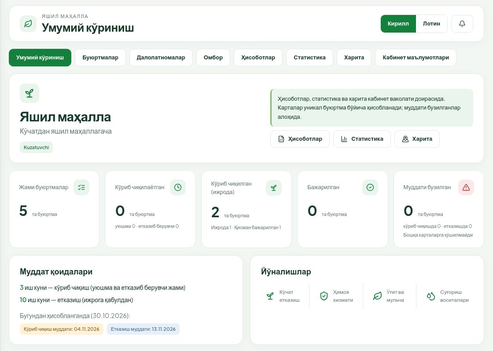

Картани боссангиз, **Ҳисоботлар** шу ҳолат сузгичи билан очилади.

---

## 3. Буюртмалар ва далолатномалар

**Буюртмалар** бўлимида бўлимлар: **Барчаси**, **Кўриб чиқилмоқда** (уюшма ва етказиб берувчида), **Ижрода**, **Бажарилган**, **Қайтарилган**. **Қидириш** — рақам ёки ном бўйича.

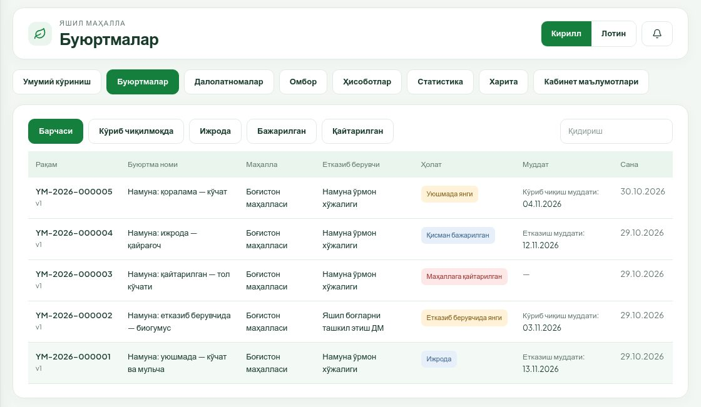

Қаторни боссангиз буюртма карточкаси очилади: босқич тасмаси, маҳалла ва етказиб берувчи, муддатлар, масъул ижрочи, жой, маҳсулотлар (буюртма / қабул қилинган / қолган), ижрога қабулдаги омбор натижаси, далолатномалар, ҳужжатлар (**Кўриш**, **Чоп этиш**, **PDF**) ва жараён журнали. Амал тугмалари йўқ.

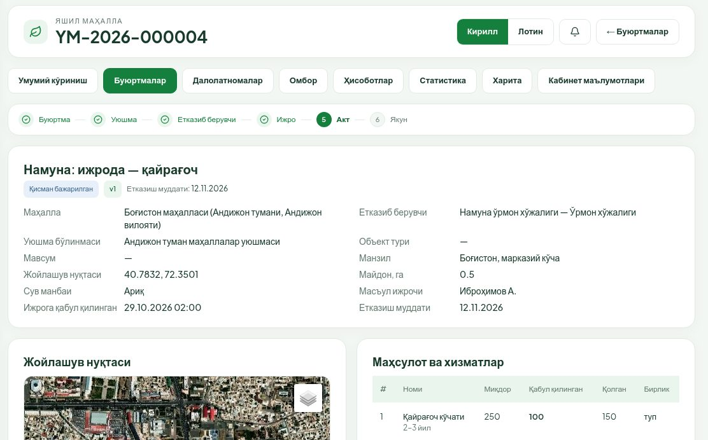

**Далолатномалар** бўлимида: **Барчаси**, **Тасдиқ кутаётган**, **Қабул қилинган**, **Рад этилган**. Акт карточкасида етказилган миқдорлар, далил файллари, имзолар ва версиялар кўринади.

---

## 4. Ҳисоботлар

**Ҳисоботлар** бўлимининг юқори ўнг қисмида иккита реестр: **Буюртмалар реестри** ва **Далолатномалар реестри**.

### 4.1. Буюртмалар реестри

Реестрда ҳар бир қатор — буюртманинг битта позицияси (маҳсулот ёки хизмат).

1. **Йўналиш**ни танланг: **Умумий**, **Ўрмон хўжаликлари** (кўчат ва мульча) ёки **Яшил боғлар ДМ** (ўғит, ускуна, суғориш, ҳимоя хизмати). Икки йўналиш алоҳида ҳисобланади.
2. Фильтрларни белгиланг:
   - **Давр асоси**: **Буюртма юборилган сана**, **Ижрога қабул санаси** ёки **Ҳақиқий етказиш санаси**; **дан** / **гача** — шу сана бўйича давр;
   - **Вилоят**, **Туман**, **Маҳалла** (кўлам доирасида);
   - **Етказиб берувчи**, **Маҳсулот / хизмат**, **Ҳолат**;
   - **Қидириш** (рақам, ном);
   - **Фақат муддати бузилган**.
3. **Устунлар** тугмаси қўшимча устунларни очади: **Ижрочи**, **Далолатномалар**, **Ҳақиқий етказиш**, **Ижро** (қабул санаси), **Манзил**, **Координата**. Танлов шу браузерда эслаб қолинади.

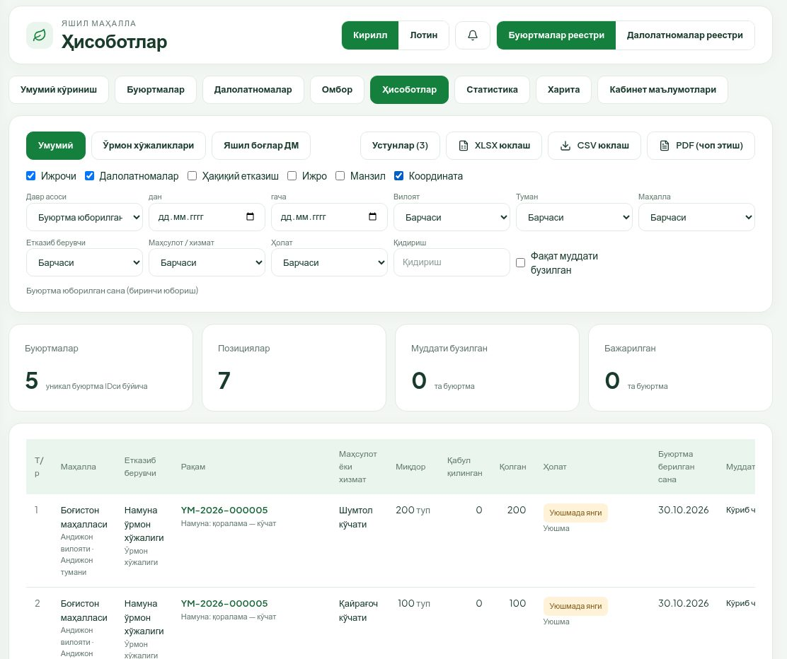

Фильтрлар остида жами блок: **Буюртмалар** (уникал буюртма IDси бўйича — бир буюртманинг бир неча позицияси бир марта саналади), **Позициялар**, **Муддати бузилган**, **Бажарилган**.

Жадвалда: маҳалла, етказиб берувчи, рақам (боссангиз буюртма очилади), маҳсулот, **Миқдор**, **Қабул қилинган**, **Қолган**, **Ҳолат** ва масъул босқич, **Буюртма берилган сана** (қайта юборилган бўлса — охирги қайта юбориш ҳам), **Муддатлар**, **Кечикиш** (иш куни ва босқич). Пастда **Маҳсулот ва бирлик кесимида** жами жадвали — турли бирликлар бир-бирига қўшилмайди.

Фильтрлар манзил сатрида сақланади: ҳисоботдан **Статистика** ёки **Харита** га ўтсангиз, шу сузгичлар қўлланади; ҳаволани ҳамкасбга юбориш ҳам мумкин (у ўз кўлами доирасида кўради).

### 4.2. Экспорт

1. Керакли фильтр ва устунларни танланг.
2. **XLSX юклаш**, **CSV юклаш** ёки **PDF (чоп этиш)** тугмасини босинг.

Экспорт экрандаги саҳифани эмас, **барча фильтрланган натижани** қамраб олади ва танланган қўшимча устунларни ҳам қўшади.

- **Кичик ҳисобот** (2000 қаторгача) — файл дарҳол юкланади.
- **Катта ҳисобот** — «Экспорт навбатга қўйилди…» хабари чиқади, файл фонда тайёрланади. Тайёр бўлганда файл ўзи юкланади ва хабарнома келади. PDF учун чегара — 5000 қатор; бир вақтда 3 тагача экспорт тайёрланиши мумкин.
- Саҳифа пастидаги **Сўнгги экспортлар** тугмаси охирги экспортлар рўйхатини очади: сана, тури, ҳолат (**Навбатда**, **Тайёрланмоқда**, **Тайёр**, **Хато**, **Муддати ўтган**), қаторлар сони ва **Юклаб олиш**. Файллар 7 кун сақланади. Ҳар ким фақат ўз экспортларини кўради.

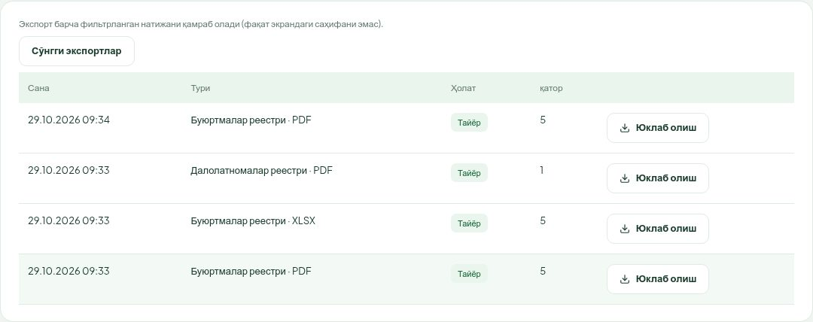

### 4.3. Далолатномалар реестри

**Далолатномалар реестри** да йўналиш ва ҳудуд фильтрлари бир хил; давр асоси — ҳақиқий етказиш санаси. Ўнгдаги рўйхатдан акт ҳолатини танлаш мумкин (**Қоралама**, **Маҳалла тасдиғида**, **Қабул қилинган**, **Тузатиш учун қайтарилган**, **Бекор қилинган**). Бу реестр ҳам XLSX, CSV, PDF га экспорт қилинади.

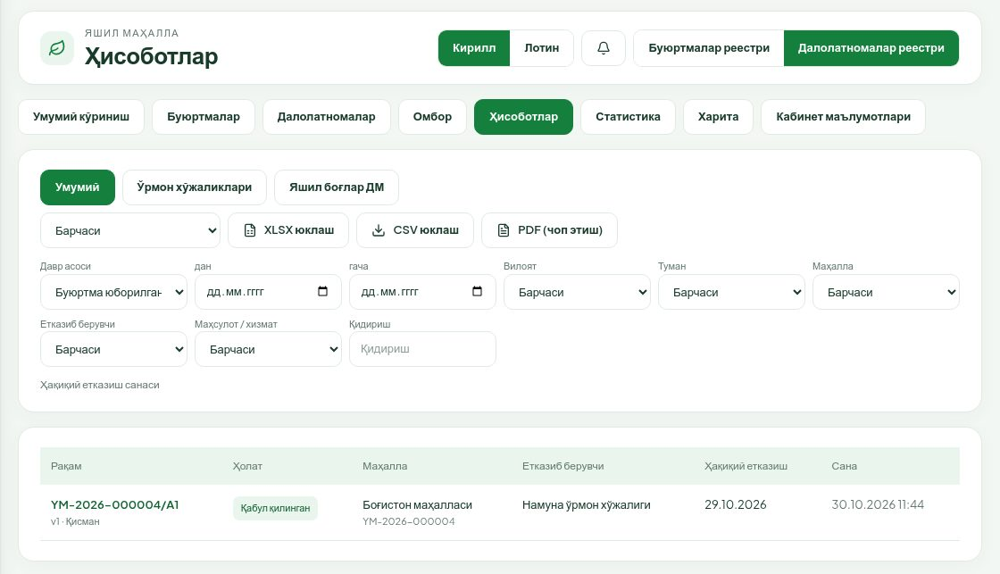

---

## 5. Статистика

**Статистика** бўлимида йўналиш ва ҳудуд фильтрлари ҳисоботдагидек.

### 5.1. Карталар

**Жами буюртмалар**, **Янги** (уюшма / етказиб берувчи), **Кўриб чиқилаётган** (уюшма / етказиб берувчи), **Кўриб чиқилган (ижрода)** (ижрода / қисман), **Бажарилган**, **Қайтарилган**, **Бекор қилинган**, **Муддати бузилган** (кўриб чиқишда / етказишда).

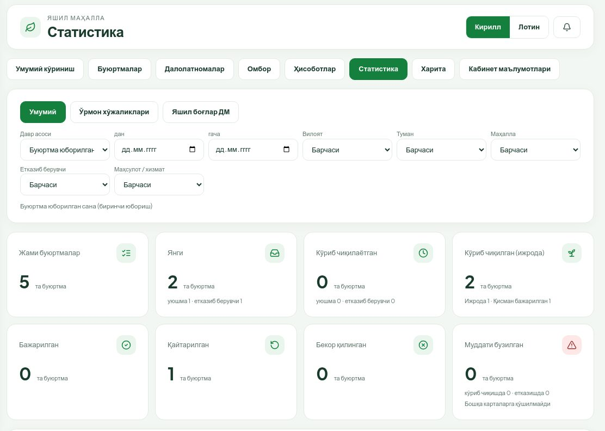

Карталар уникал буюртма бўйича ҳисобланади. **Муддати бузилган** картаси бошқа карталарга қўшилмайди (бир буюртма ҳам «ижрода», ҳам «муддати бузилган» бўлиши мумкин). Картани боссангиз, реестр шу ҳолат билан очилади.

### 5.2. Кўчатлар бўйича фарқ

Ҳар кўчат тури бўйича: **Буюртма қилинган**, **Қабул қилинган** (икки томон имзолаган актлар), **Тасдиқ кутилмоқда** (маҳалла тасдиғидаги актлар), **Қайтарилган эҳтиёж**, **Фарқ** ва бажарилиш фоизи чизиғи. Пастда **Жами**.

Фарқ = буюртма қилинган − икки томон тасдиқлаган етказиш. Қоралама ва бекор қилинган ҳажм ҳисобга кирмайди.

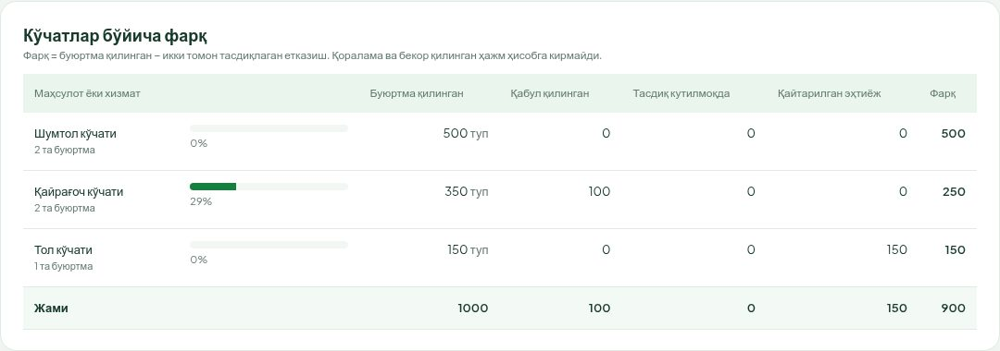

### 5.3. Орқада қолаётган ташкилотлар

Уюшма бўлинмалари ва етказиб берувчилар бўйича: **Жами**, **Ижрода**, **Бажарилган**, **Кўриб чиқишда кечиккан**, **Етказишда кечиккан**, **Энг катта кечикиш** (иш куни), **Бажарилиш, %**. Кечикиш ҳужжат айни кимда турганига қараб ўша ташкилотга ёзилади; кечикиши бор ташкилот ёнида қизил **Кечикиш бор** белгиси. Рўйхат кечикишлар сони ва давомийлиги бўйича сараланади.

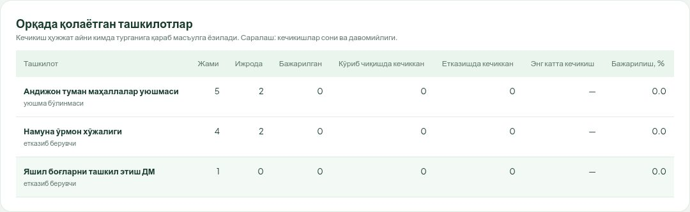

---

## 6. Харита

**Харита** бўлимида **ижрога қабул қилинган** буюртмалар нуқта бўлиб кўринади (қораламалар ва ҳали қабул қилинмаганлар чиқмайди).

- Ранглар: кўк — **Ижрода**, сариқ-жигарранг — **Қисман бажарилган**, яшил — **Бажарилган**, тўқ қизил — **Муддати бузилган**.
- Фильтрлар ҳисоботдагидек (йўналиш, давр, ҳудуд, етказиб берувчи, маҳсулот, ҳолат, **Фақат муддати бузилган**). Ўнг юқорида нуқталар сони.
- Яқин нуқталар рақамли доирачага (кластерга) бирлашади; уни боссангиз харита яқинлашади, бир манзилдаги буюртмалар ёйилиб кўрсатилади.
- **Фақат кўринаётган ҳудуд** белгиси — фақат экрандаги харита қисмидаги нуқталарни сўрайди (нуқталар жуда кўп бўлганда; бир сўровда 5000 тагача нуқта).
- Харита қатламини ўнг юқоридаги тугма билан алмаштириш мумкин.

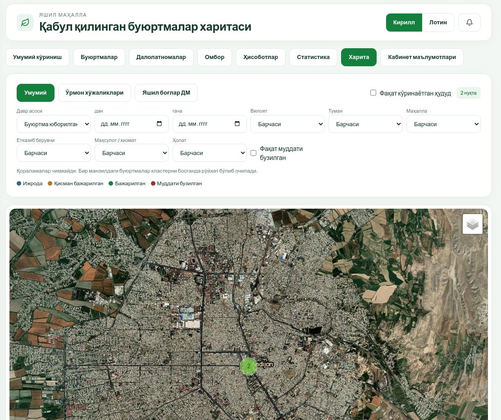

Нуқтани боссангиз ойнача очилади: рақам ва ҳолат, номи, маҳалла, етказиб берувчи, майдон, позициялар (буюртма ва қабул қилинган миқдор), етказиш муддати ва кечикиш. **Карточкани очиш →** буюртма карточкасига ўтади.

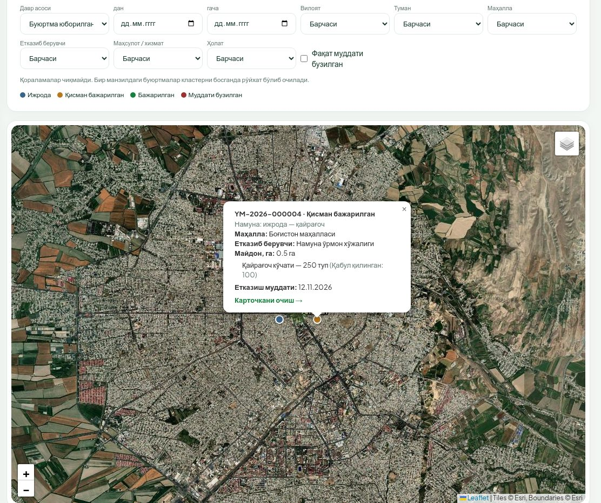

---

## 7. Етказиб берувчилар омбори

**Омбор** бўлимида кузатувчи етказиб берувчилар омборини **фақат кўради**.

1. **Етказиб берувчини танланг** рўйхатидан ташкилотни танланг. Етишмовчилиги бор ташкилот ёнида «N та позицияда етишмовчилик» ёзилади. Рўйхатда кўламингиздаги маҳаллаларга хизмат қиладиган етказиб берувчилар бор.
2. Жадвалда ҳар позиция бўйича: **Бошланғич**, **Кирим**, **Ажратилган**, **Тикланган**, **Ҳисоб қолдиғи**, **Етишмовчилик**. Манфий қолдиқ ва қизил **Етишмовчилик** белгиси — ўрмон хўжалигида таъминланмаган эҳтиёж (буюртма қабул қилинган, лекин омборда етарли кирим йўқ).
3. ДМ учун **Хизмат қуввати (ой бўйича)** блоки ҳам кўринади (ойни **Давр** да танланг).
4. **Ҳаракатлар тарихи**: кирим, бошланғич қолдиқ, ажратиш, тиклаш, тескари операциялар — ҳужжат рақами, асоси, ким киритгани ва ҳолати билан. Позиция қаторини боссангиз тарих шу позиция бўйича сузгичланади.

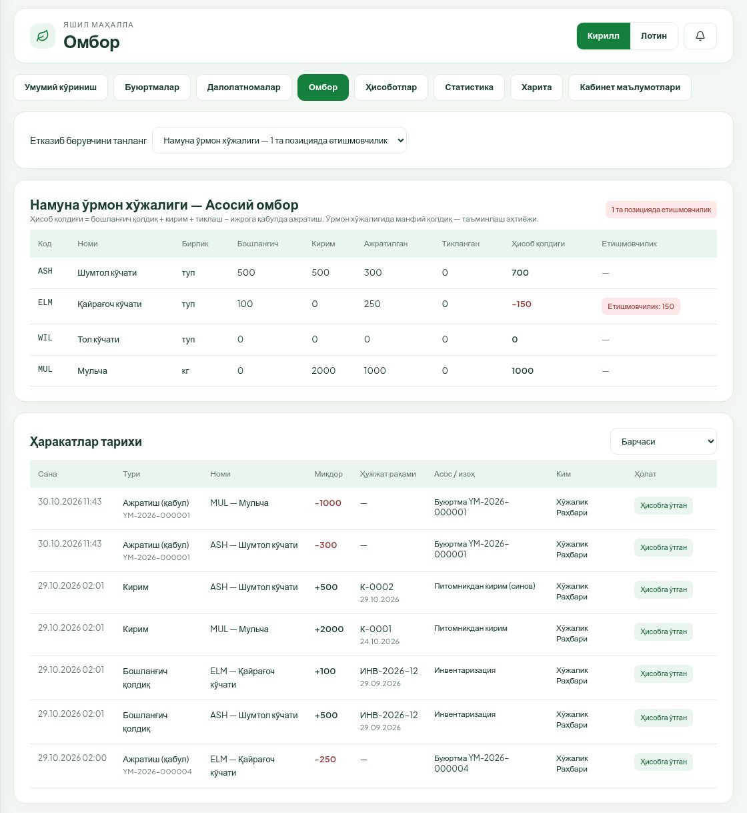

Кирим, бошланғич қолдиқ, тескари операция ва қувват киритиш тугмалари кузатувчида йўқ — бу амалларни етказиб берувчининг ўзи бажаради.
