# «Яшил маҳалла»: модул маъмури қўлланмаси

Қўлланма **модул маъмури** учун: ким қайси кабинетда ишлашини, маҳаллалар, уюшма бўлинмалари, етказиб берувчилар, бириктиришлар, каталог, иш календари, хизмат қуввати ва бизнес қоидаларини «Маъмурият» саҳифасида юритиш.
Тизимга кириш ва умумий элементлар [умумий қўлланмада](qollanma-umumiy.md) ёритилган. Кузатиш имкониятлари (ҳисобот, статистика, харита, омбор) [кузатувчи қўлланмасида](qollanma-kuzatuvchi.md).
Расмлар намуна (синов) маълумотлари билан олинган.

---

## 1. Модул маъмури ким

- Модул маъмури — STAT-URMON'нинг **суперадмини** ёки платформада «Яшил маҳалла» модулини бошқариш ҳуқуқи берилган фойдаланувчи. Бу ҳуқуқ модул ичида эмас, платформанинг фойдаланувчилар бўлимида берилади.
- Маъмурда модул менюсида қўшимча **Маъмурият** тугмаси бор. Бошқа ҳеч бир кабинет (маҳалла, уюшма, етказиб берувчи, кузатувчи) бу саҳифани очолмайди.
- Фойдаланувчи ва ташкилотлар модулда **яратилмайди** — улар платформада мавжуд бўлиши керак. Модулда мавжуд фойдаланувчига **аъзолик** (кабинет) берилади, мавжуд ташкилот **етказиб берувчи** қилинади.

**Кабинет билан ишлаш.** Маъмурнинг ўзида аъзолик бўлмаса, у барча маълумотни кўради, лекин буюртма, акт ва омбор амалларини бажармайди. Маъмурда аъзолик бўлса (масалан, кузатувчи), буюртма, ҳисобот ва омбор бўлимлари шу кабинет номидан ва унинг кўламида ишлайди; **Маъмурият** саҳифаси эса ҳар доим тўлиқ очиқ.

**Чекловлар:**

- маъмур бошқа шахс номидан имзо қўя олмайди (имзо фақат сертификат эгасининг ўз ЖШШИРи билан);
- буюртма, акт, имзо, омбор ҳаракати ва тарихни ўчириш маршрути йўқ;
- маълумотномалардан фақат календарь кунларини ўчириш мумкин; қолганлари «нофаол» қилинади ёки амал муддати ёпилади;
- имзоланган ҳужжатлардаги номлар маълумотнома ўзгарганда ўзгармайди.

Ҳар бир ўзгариш **Журнал** бўлимига ёзилади.

---

## 2. Маъмурият саҳифаси

**Маъмурият** тугмасини босинг. Юқорида бўлимлар: **Аъзоликлар**, **Календарь**, **Маҳаллалар**, **Бириктиришлар**, **Каталог ва қувват**, **Қоидалар**, **Журнал**. Танланган бўлим манзилда сақланади (`?tab=…`), саҳифани янгиласангиз ўша бўлим очилади.

Барча формаларда сақлаш **Сақлаш** тугмаси билан, бекор қилиш **Бекор қилиш** ёки Esc билан. Хато бўлса, ойна пастида сабаб ёзилади ва хато майдон қизил бўлади.

---

## 3. Аъзоликлар

Аъзолик — фойдаланувчининг модулдаги кабинети: тури, объекти, ҳуқуқлари ва амал даври. Аъзолиги бўлмаган фойдаланувчи модулга кирса «Сиз модулга бириктирилмагансиз» хабарини кўради.

Рўйхатда: **Фойдаланувчи** (исм, email), **Кабинет** (тури ва объекти; кузатувчида — ҳудуд кодлари ёки «РУз»), **Ҳуқуқлар** (**Тайёрлайди**, **Имзолайди**), **Лавозим** ва ваколат ҳужжати рақами, **Амал қилиш даври**, **Ҳолат** (**Фаол**, **Нофаол**, **Муддати тугаган**). Тепада қидириш ва тур бўйича сузгич.

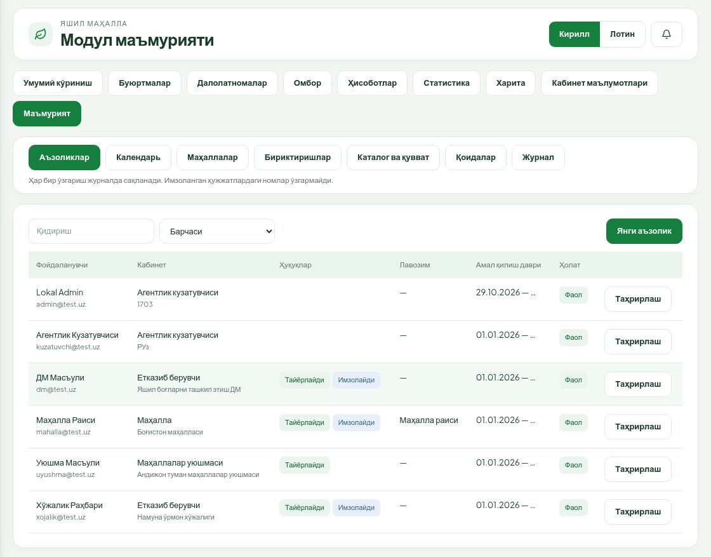

### 3.1. Янги аъзолик

1. **Янги аъзолик** тугмасини босинг.
2. **Фойдаланувчини қидириш** — email ёки фамилиянинг камида 2 белгисини ёзинг ва рўйхатдан танланг.
3. **Тури**: **Маҳалла**, **Маҳаллалар уюшмаси**, **Етказиб берувчи** ёки **Агентлик кузатувчиси**.
4. Объектни танланг: маҳалла (қидириш билан), уюшма бўлинмаси ёки етказиб берувчи ташкилот (фақат фаол етказиб берувчилар чиқади, 6.4-бўлим).
5. Ҳуқуқлар: **Тайёрлайди** — ҳужжат тайёрлаш, ижрога қабул, омбор амаллари; **Имзолайди** — E-IMZO билан имзолаш, тескари операцияни тасдиқлаш, ДМ қувватини киритиш. Иккаласи бирга бўлиши мумкин.
6. **Лавозим**, **Телефон**, **Ваколат асоси №** ва **Ваколат асоси — сана** (имзоловчилар учун буйруқ ёки ишончнома реквизити).
7. **Амал бошланиши** (мажбурий) ва **Амал тугаши** (ихтиёрий).
8. **Сақлаш**.

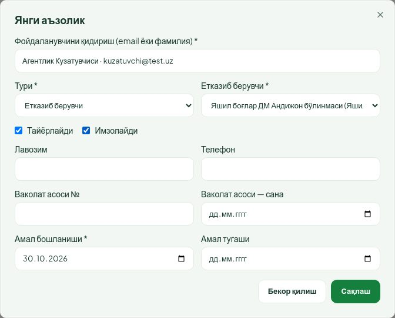

**Кузатувчи кўлами.** Тур **Агентлик кузатувчиси** бўлса ҳуқуқ белгилари ўрнига **Ҳудуд кодлари (вергул билан); бўш — республика** майдони чиқади. Вилоят кодлари (4 белгигача) ва туман кодлари (узунроқ) вергул билан ёзилади, масалан `1703` ёки `1703, 1727224`. Бўш қолса — бутун республика. Кузатувчида тайёрлаш ва имзолаш ҳуқуқи бўлмайди.

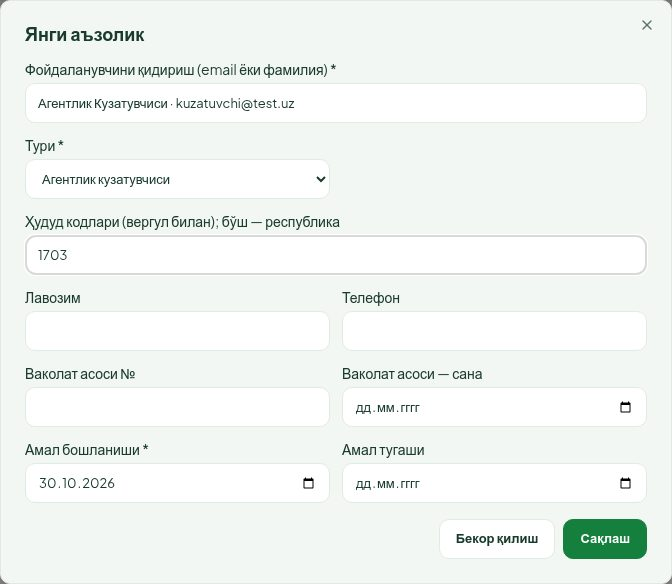

**Имзоловчи учун:** платформадаги фойдаланувчи профилида ЖШШИР тўлдирилган бўлиши шарт — имзода сертификат ЖШШИРи шу билан солиштирилади. Етказиб берувчи ташкилотнинг СТИРи кўрсатилган бўлса, сертификатдаги СТИР ҳам унга мос бўлиши керак.

### 3.2. Аъзоликни ўзгартириш ва ёпиш

- **Таҳрирлаш** — ҳуқуқлар, лавозим, телефон, ваколат ҳужжати, **Амал тугаши** ва **Фаол** белгиси ўзгаради.
- Аъзолик тури ва кабинети ўзгармайди: керак бўлса янги аъзолик яратинг ва эскисини ёпинг.
- Аъзолик ўчирилмайди. Ходим ишдан кетса **Амал тугаши** ни қўйинг ёки **Фаол** белгисини олиб ташланг — кабинет йўқолади, у қўйган имзолар тарихда сақланади.
- Бир фойдаланувчида бир нечта аъзолик бўлса, у модул сарлавҳасидаги **Кабинет** рўйхатидан алмаштиради.

---

## 4. Маҳаллалар

Модулнинг маҳаллалар маълумотномаси: **Код** (манба коди), **Номи** ва манзил, вилоят ва туман, **Амал қилиш даври**, ҳолат.

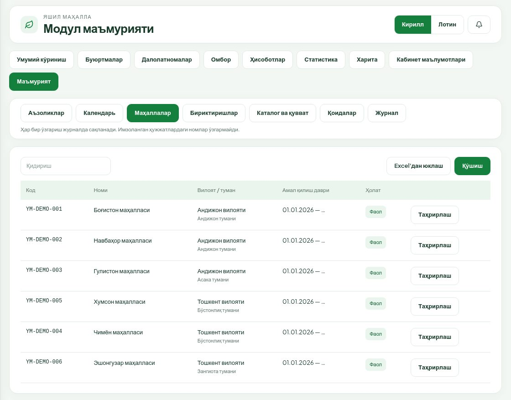

- **Қўшиш** — вилоят, туман, ном (мажбурий), манба коди, манзил, амал тугаши, **Фаол** белгиси.
- **Таҳрирлаш** — шу майдонлар. Маҳалла ўчирилмайди; ишлатилмаса **Фаол** белгисини олинг ёки амал тугашини қўйинг.
- **Манба коди** импортда калит бўлади: файлда шу код бўлса, мавжуд маҳалла янгиланади.

### 4.1. Excel'дан юклаш (текшириш билан)

Барча импорт ойналари бир хил ишлайди (маҳаллалар, бириктиришлар, маршрутлар, календарь).

1. **Excel'дан юклаш** тугмасини босинг. Ойнада керакли **Устунлар** рўйхати ёзилган. Маҳаллалар учун: `манба коди | вилоят коди | туман коди | маҳалла номи | манзил | фаол | амал бошланиши | амал тугаши`. Сарлавҳалар кирилл ёки лотинда бўлиши мумкин; саналар `кк.оо.йййй` ёки `йййй-оо-кк`; «фаол» устунига ҳа / йўқ.
2. .xlsx файлни танланг (10 МБгача).
3. **Текшириш** ни босинг. Бу синов ўтказиш: **ҳеч нарса ёзилмайди**. Натижада: «янги», «янгиланади», «ўзгаришсиз», «хато» сони ва хато қаторлар (қатор рақами ва сабаби).
4. Хатоларни файлда тузатиб, файлни қайта танланг ва яна **Текшириш** ни босинг.
5. Хато қолмаса ва ўзгариш бўлса **Тасдиқлаш ва ёзиш** тугмаси очилади. Ёзиш «ҳаммаси ёки ҳеч нарса» тамойилида бажарилади.

Расмдаги мисолда иккита қатор мавжуд маҳаллаларни янгилайди, битта қаторда туман коди бўш — шу сабаб **Тасдиқлаш ва ёзиш** ёпиқ.

---

## 5. Календарь

Иш кунлари ҳисоби: шанба ва якшанба — дам олиш; қўшимча **Байрам / дам олиш** ва **Кўчирилган иш куни** (дам олиш кунига кўчирилган иш куни) шу ерда киритилади. Кўриб чиқиш (3 иш куни) ва етказиш (10 иш куни) муддатлари шу календарь бўйича ҳисобланади.

1. **Йил** ни танланг.
2. **Қўшиш** — **Сана**, **Тури**, изоҳ ва асос ҳужжат (масалан, ҳукумат қарори рақами) → **Сақлаш**.
3. Ёки **Excel'дан юклаш** — устунлар `сана | тури (байрам / иш куни) | изоҳ`, асос ҳужжатни ойнанинг **Асос ҳужжат (рақам, сана)** майдонига ёзинг.
4. Нотўғри кунни **Ўчириш** билан олиб ташланг (браузер тасдиқ сўрайди). Календарь — ўчириладиган ягона маълумотнома.

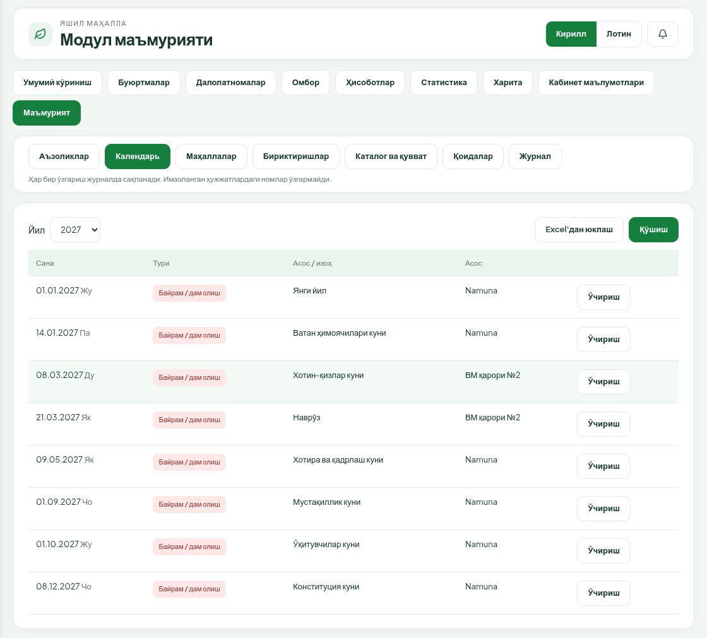

Календарь ўзгарса, очиқ буюртмаларнинг кўриб чиқиш муддати янги календарь билан қайта ҳисобланади; ижрога қабулда белгиланган етказиш муддати ўзгармайди. Шунинг учун йиллик календарни йил бошидан олдин бир марта, тасдиқланган манба асосида киритинг.

---

## 6. Бириктиришлар

**Бириктиришлар** бўлимида тўртта ички бўлим: **Маҳалла → ўрмон хўжалиги**, **Маҳалла → уюшма бўлинмаси**, **Уюшма бўлинмалари**, **Етказиб берувчилар**.

### 6.1. Маҳалла → ўрмон хўжалиги

Маҳалла буюртма берганда асосий ўрмон хўжалиги шу жадвалдан автоматик танланади. Бир маҳаллага бир вақтда фақат битта амалдаги бириктириш бўлади (даврлар кесишмайди). Бириктириш топилмаса, маҳалла хўжаликни ўзи танлайди.

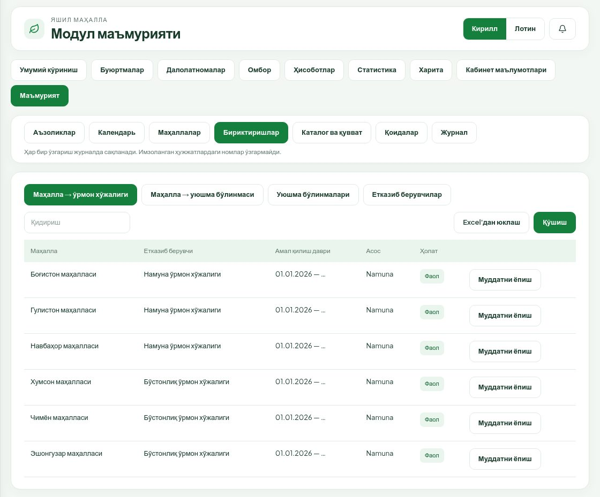

- **Қўшиш** — маҳалла, етказиб берувчи (фаол ўрмон хўжаликлари), **Амал бошланиши**, ихтиёрий **Амал тугаши**, **Асос ҳужжат (рақам, сана)**.
- **Муддатни ёпиш** — фақат **Амал тугаши** ва асосни ўзгартиради. Бириктириш ўчирилмайди.
- **Хўжаликни алмаштириш:** эски бириктиришда **Муддатни ёпиш** билан охирги кунни қўйинг, кейин янги бириктиришни кейинги кундан бошлаб қўшинг.
- **Excel'дан юклаш** — устунлар `маҳалла коди | хўжалик (ID ёки аниқ номи) | амал бошланиши | амал тугаши`; асос ҳужжат ойнада ёзилади.

### 6.2. Маҳалла → уюшма бўлинмаси (маршрут)

Маҳалла имзолаб юборган буюртма шу жадвалдаги уюшма бўлинмасига тушади. Бириктириш бўлмаса маҳалла буюртмани юбора олмайди. Ишлаш тартиби 6.1-бўлимдагидек (**Қўшиш**, **Муддатни ёпиш**, **Excel'дан юклаш**; устунлар `маҳалла коди | уюшма бўлинмаси (ID ёки номи) | амал бошланиши | амал тугаши`).

Маршрут ўзгарса, аввал юборилган буюртмалар эски бўлинмада қолади; янгилари янги бўлинмага тушади.

### 6.3. Уюшма бўлинмалари

Рўйхатда: номи ва СТИР, **Даража** (Туман, Вилоят, Республика), вилоят/туман, бириктирилган маҳаллалар сони, ҳолат.

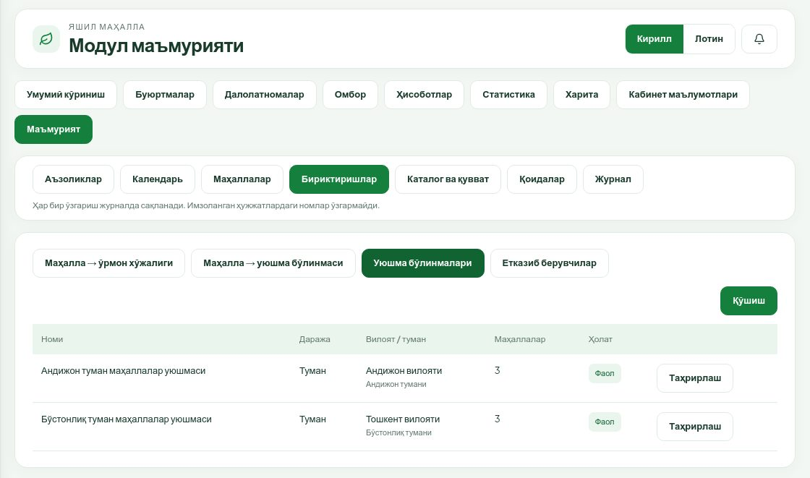

**Қўшиш** / **Таҳрирлаш**: **Номи** (мажбурий), **Даража**, СТИР, вилоят, туман, **Юқори бўлинма** (вилоят ёки республика даражасидаги бўлинма), **Фаол**. Бўлинма ўчирилмайди — нофаол қилинади.

### 6.4. Етказиб берувчилар

Платформадаги ташкилот модулда ишлаши учун у **етказиб берувчи** қилинади. Рўйхатда: ташкилот, тури (**Ўрмон хўжаликлари** ёки **Яшил боғлар ДМ**), **Хизмат ҳудуди** (ДМ учун), аъзолар сони, ҳолат.

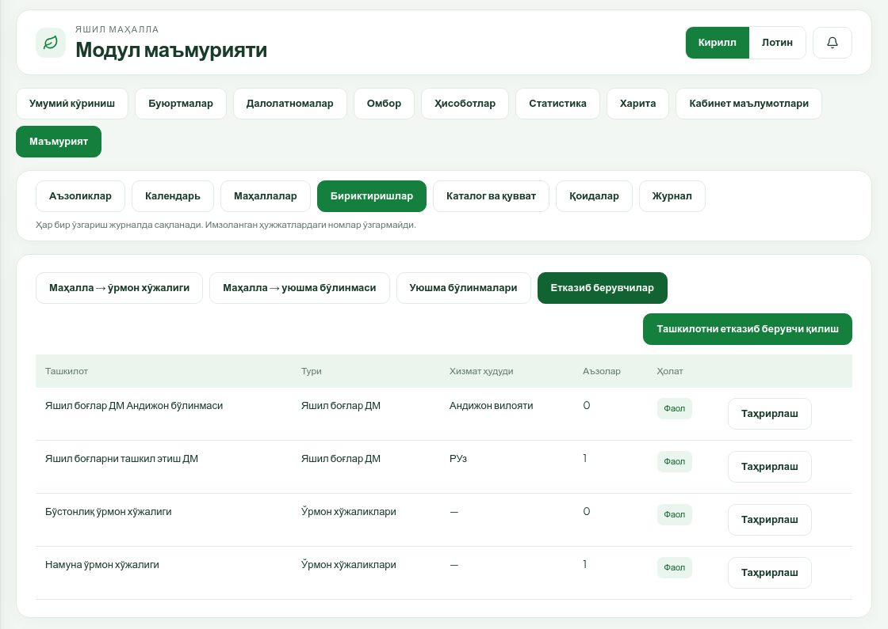

**Ташкилотни етказиб берувчи қилиш:**

1. **Ташкилотни қидириш** — номнинг камида 2 белгиси; аллақачон етказиб берувчи бўлган ташкилотни танлаб бўлмайди.
2. **Тури** — ўрмон хўжалиги ёки ДМ (кейин ўзгармайди).
3. Расмий ном ва СТИР (имзода сертификат СТИРи шу билан солиштирилади).
4. ДМ учун: **Юқори бўлинма** (ДМнинг вилоят бўлинмаси бўлса) ва **Хизмат ҳудуди** — вилоятлар. Ҳудуд белгиланмаса — бутун республика («РУз»). Маҳалла ДМни танлаганда ва кузатувчи омборларни кўрганда шу ҳудуд ҳисобга олинади.
5. **Фаол** белгиси ва **Сақлаш**.

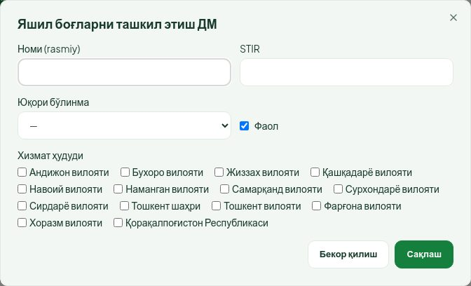

Етказиб берувчи ўчирилмайди; ишламаса **Фаол** белгисини олинг (у аъзолик ва бириктириш рўйхатларидан чиқади).

---

## 7. Каталог ва қувват

### 7.1. Каталог

Рўйхатда: **Код**, **Номи**, **Тури** (йўналиш), **Категория**, **Бирлик**, **Версия**, ҳолат. Нарх юритилмайди.

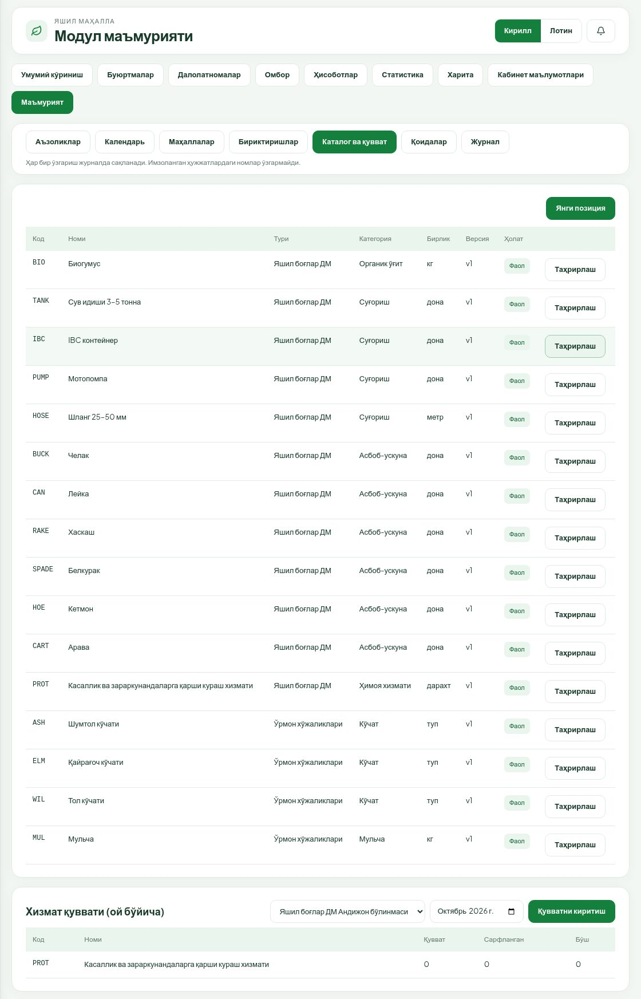

Категориялар: ўрмон хўжалиги учун **Кўчат**, **Мульча**; ДМ учун **Органик ўғит**, **Асбоб-ускуна**, **Суғориш**, **Ҳимоя хизмати** (хизмат — омборда эмас, ойлик қувват орқали). Бирликлар: туп, дона, комплект, дарахт, кг, метр, га.

- **Янги позиция** — код, йўналиш, ном (кирилл — мажбурий, лотин), категория, бирлик, тартиб рақами, **Фаол**, хусусиятлар (масалан, кўчат ёши ва бўйи; JSON кўринишида, масалан `{"ёш": "2–3 йил", "бўй": "1–1,5 м"}`).
- **Таҳрирлаш** — **Код, йўналиш, тур ва бирлик ўзгармайди**. Ном ўзгарса позиция версияси ошади; аввал имзоланган ҳужжатлардаги ном ўзгармайди.
- Позиция ўчирилмайди — **Фаол** белгисини олинг, у янги буюртмаларда чиқмайди.

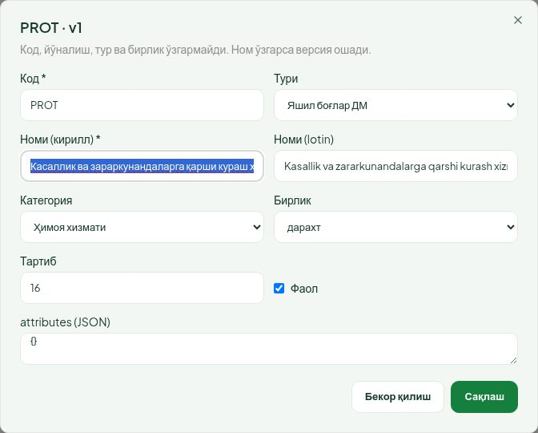

Маҳсулот меъёрлари (масалан, биогумус ва мульчанинг туп бошига меъёри) бу саҳифада юритилмайди.

### 7.2. ДМ хизмат қуввати

Каталог остидаги **Хизмат қуввати (ой бўйича)** блокида ДМ ташкилоти ва ой танланади; ҳар хизмат бўйича **Қувват**, **Сарфланган**, **Бўш**. **Қувватни киритиш** — ҳар хизмат учун ойлик қувват → **Сақлаш**. Қувват сарфланган ҳажмдан кам бўлмайди. ДМ ижрога қабулда хизмат сатрини шу қувватдан олади; етмаса қабул рад этилади. ДМнинг имзоловчи ходими ҳам ўз ташкилоти қувватини «Омбор» саҳифасида киритиши мумкин.

---

## 8. Қоидалар

Бизнес қоидалари версияли сақланади. Ҳозирги қоидалар:

| Қоида | Стандарт | Рухсат этилган оралиқ |
|---|---|---|
| Кўриб чиқиш муддати (уюшма + етказиб берувчи жами), иш куни | 3 | 1–30 |
| Етказиш муддати (ижрога қабулдан), иш куни | 10 | 1–60 |
| Далолатнома тасдиғи эслатмаси, иш кунидан кейин | 3 | 1–30 |
| Ўрмон хўжалигида манфий қолдиққа рухсат (ДМда ҳар доим қатъий) | ҳа | ҳа / йўқ |

Жадвалда: номи ва калити, **Қиймат** (ўзгартирилмаган бўлса «стандарт»), **Кутилмоқда** (келажак санадан кучга кирадиган версия), **Тарих (N)** ҳаволаси — барча версиялар: қиймат, кучга кириш санаси, ким ўзгартиргани, вақти ва асоси.

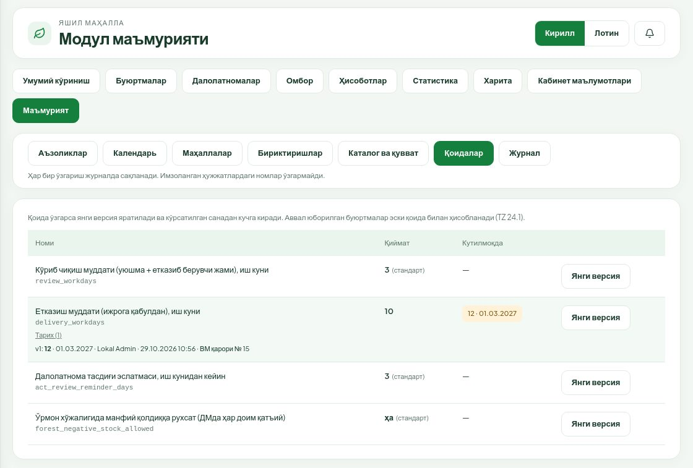

**Қоидани ўзгартириш:**

1. Қатордаги **Янги версия** тугмасини босинг.
2. **Қиймат** ва **Кучга кириш** санасини киритинг (бугундан олдинги сана бўлмайди).
3. **Асос ҳужжат (рақам, сана)** ни ёзинг ва **Сақлаш** ни босинг.

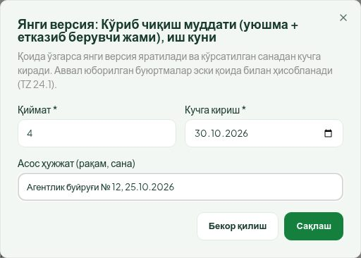

Қандай қўлланади:

- эски версия ўчирилмайди, янгиси кўрсатилган санадан кучга киради (ўзгариш бир дақиқа ичида кучга киради);
- кўриб чиқиш муддати — буюртма биринчи юборилган кундаги қоида бўйича; етказиш муддати ва ўрмон манфий қолдиқ сиёсати — ижрога қабул кунидаги қоида бўйича. Аввал юборилган буюртмалар эски қоида билан ҳисобланади;
- келажак санали бир нечта ўзгаришни сана тартибида киритинг.

Қайтарилган даврни муддатдан чиқариш, ДМдаги қатъий текширув, эслатма нуқталари ва иш куни ҳисоби экрандан ўзгармайди.

---

## 9. Журнал

**Журнал** бўлимида маълумотнома ва созламалар ўзгаришлари: **Сана**, **Фойдаланувчи**, **Амал** (яратилди / ўзгартирилди / ўчирилди), **Объект** (тури ва қисқа тавсифи). Объект тури бўйича сузгич ва қидириш бор. Журнал фақат ўқиш учун.

Объект тури: аъзолик, маҳалла, уюшма бўлинмаси, уюшма йўналиши, етказиб берувчи, хўжалик бириктириши, календарь куни, каталог позицияси, хизмат қуввати ёки қоида.

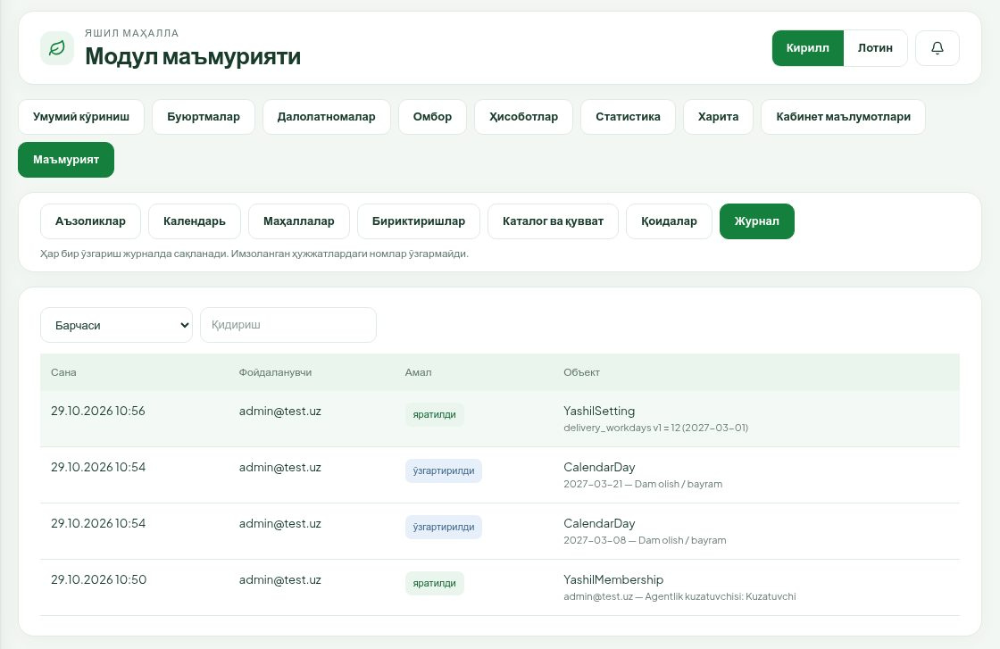

Буюртма, акт ва омбор амаллари бу журналда эмас — улар ҳар бир буюртма карточкасидаги **Жараён журнали** да ва омбордаги **Ҳаракатлар тарихи** да.

---

## 10. Бошланғич маълумотларни юклаш тартиби

Ишга тушириш учун тавсия этилган кетма-кетлик (ТТ §19.2 асосида). Ҳар бир Excel импортини аввал **Текшириш** билан синанг.

1. **Платформада** ташкилотлар (ўрмон хўжаликлари, ДМ ва унинг бўлинмалари, уюшмалар) ва фойдаланувчилар борлигини, имзоловчилар профилида ЖШШИР тўлдирилганини текширинг.
2. **Календарь** — йиллик байрам ва кўчирилган иш кунлари, тасдиқланган манба реквизити билан.
3. **Маҳаллалар** — Excel'дан, манба кодлари билан.
4. **Уюшма бўлинмалари** — даража ва юқори бўлинма билан.
5. **Етказиб берувчилар** — ўрмон хўжаликлари ва ДМ, расмий ном ва СТИР; ДМ учун хизмат ҳудуди.
6. **Маҳалла → ўрмон хўжалиги** бириктиришлари — Excel'дан, асос ҳужжат билан.
7. **Маҳалла → уюшма бўлинмаси** маршрутлари — Excel'дан.
8. **Каталог** — позициялар, бирликлар, хусусиятлар.
9. **Аъзоликлар** — ҳар бир ташкилот учун тайёрловчи ва имзоловчилар (ваколат ҳужжати реквизитлари билан), кузатувчилар ва уларнинг кўлами.
10. **ДМ хизмат қуввати** — биринчи ойлар учун.
11. **Бошланғич омбор қолдиқлари** — буни етказиб берувчиларнинг ўзи «Омбор» саҳифасида (қўлда ёки Excel'дан) инвентаризация ҳужжати асосида, масъул ташкилот тасдиғи билан киритади.
12. **Қоидалар** — муддатлар ва ўрмон манфий қолдиқ сиёсатини текширинг.

Шундан кейин камида битта маҳалла, битта ўрмон хўжалиги, ДМ, уюшма ва кузатувчи билан тўлиқ пилот ўтказилади: буюртма → уюшма → етказиб берувчи → ижрога қабул → далолатнома → маҳалла тасдиғи, қолдиқларни солиштириш ва имзоларни текшириш. Пилотдан кейин ишчи муҳитга ўтилади.
