# «Яшил маҳалла»: маҳалла кабинети қўлланмаси

**Кимлар учун.** Маҳалла номидан буюртма тузадиган ходимлар (тайёрловчи) ва буюртмани ҳамда далолатномани E-IMZO билан имзолайдиган раҳбар (имзоловчи) учун. Тизимга кириш, ҳолатлар, муддатлар, ҳужжатлар ва QR текшириш [умумий қўлланмада](qollanma-umumiy.md) ёзилган — аввал уни ўқинг.

---

## 1. Тайёрловчи ва имзоловчи

Маҳалла кабинетида иккита алоҳида ҳуқуқ бор. Сизда қайсилари борлигини **Кабинет маълумотлари** бўлимида кўрасиз («Ҳужжат тайёрлайди», «Имзолайди»). Бир ходимда иккаласи ҳам бўлиши мумкин.

| Амал | Тайёрловчи | Имзоловчи |
|---|---|---|
| Буюртма қораламасини яратиш ва таҳрирлаш, файл қўшиш | ✓ | — |
| Буюртмани имзолаб уюшмага юбориш | — | ✓ |
| Қоралама ёки қайтарилган буюртмани бекор қилиш | ✓ | — |
| Ижродаги буюртма бўйича бекор қилиш сўрови, етказиб берувчи сўровига розилик ёки рад | ✓ | — |
| Далолатномани имзолаб қабул қилиш | — | ✓ |
| Далолатномани изоҳ билан қайтариш | ✓ | ✓ |

Амалда: тайёрловчи буюртмани тўлдириб **Қоралама сақлаш** ни босади, имзоловчи уни очиб **Имзолаб юбориш** ни босади. Иккала ҳуқуқ бир ходимда бўлса, у буюртмани тўлдириб, шу заҳоти имзолаб юбора олади.

## 2. Умумий кўриниш

**Яшил маҳалла** очилганда **Умумий кўриниш** саҳифаси чиқади.

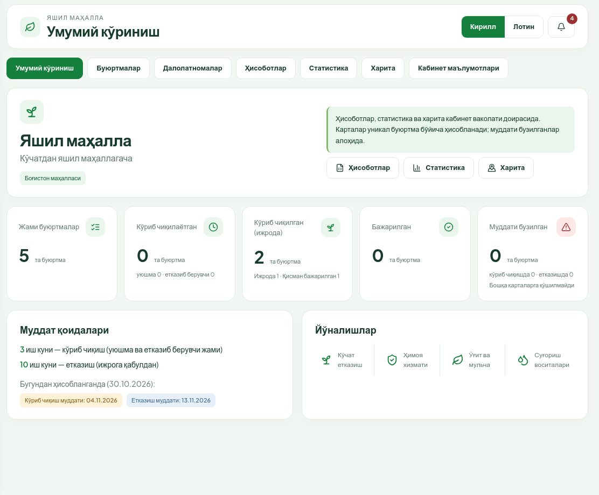

- Юқорида — маҳаллангиз номи ва **Ҳисоботлар**, **Статистика**, **Харита** га тез ўтиш тугмалари.
- Карточкалар: **Жами буюртмалар**, **Кўриб чиқилаётган** (уюшмада ва етказиб берувчида), **Кўриб чиқилган (ижрода)**, **Бажарилган**, **Муддати бузилган**. Қораламалар бу ҳисобга кирмайди.
- **Муддат қоидалари** — бугун юборилган буюртма қачонгача кўриб чиқилиши ва етказилиши керак.

## 3. Буюртмалар рўйхати

1. **Буюртмалар** бўлимини очинг.
2. Юқоридаги тугмалар билан саралаш: **Барчаси**, **Қоралама**, **Юборилган** (уюшма ёки етказиб берувчида), **Қайтарилган**, **Ижрода** (ижрода ва қисман бажарилган), **Бажарилган**, **Бекор қилинган**.
3. **Қидириш** майдонига буюртма рақами ёки номидан бир қисмини ёзинг.
4. Буюртмани очиш учун қаторни босинг.

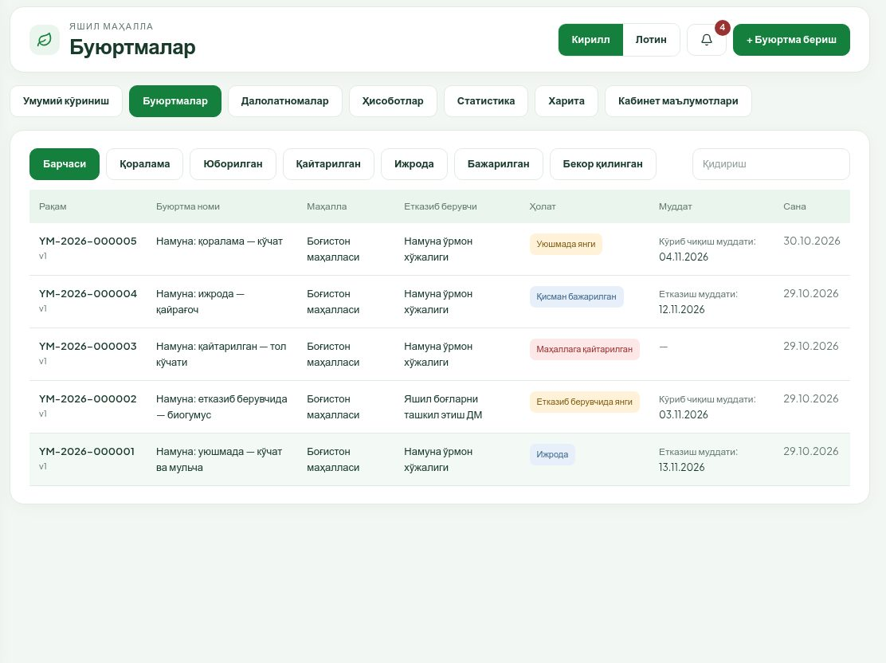

Устунлар: **Рақам** (остида версия), **Буюртма номи**, **Маҳалла**, **Етказиб берувчи**, **Ҳолат**, **Муддат**, **Сана** (охирги юборилган ёки яратилган сана). Рўйхат 20 тадан саҳифаланади (‹ ›).

## 4. Янги буюртма тузиш

Тугма фақат тайёрловчи ҳуқуқи бор ходимга кўринади.

1. **Буюртмалар** бўлимида юқори ўнгдаги **+ Буюртма бериш** ни босинг.
2. Бир саҳифада тўртта қисмни тўлдиринг (қуйида). Юлдузча (*) — мажбурий майдон.

### 4.1. Етказиб берувчи

1. Йўналишни танланг:
   - **Ўрмон хўжалиги — кўчат ва мульча**;
   - **ДМ — ўғит, ускуна, суғориш, ҳимоя хизмати**.
2. Ўрмон хўжалиги йўналишида маҳаллангизга бириктирилган **асосий ўрмон хўжалиги** ўзи танланади. Бошқа хўжалик керак бўлса — **Бошқа хўжаликни танлаш** ни босинг ва пастда очилган рўйхатдан танланг (тугма маҳаллага муқобил хўжаликлар бириктирилган бўлса кўринади).
3. ДМ йўналишида бир нечта ДМ бўлса, рўйхатдан танланг.

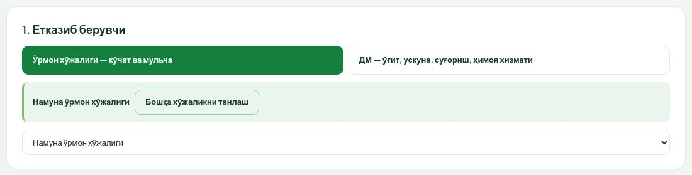

Йўналиш алмаштирилса, киритилган маҳсулот қаторлари тозаланади. «**Хўжалик бириктирилмаган — рўйхатдан танланг**» ёзуви чиқса, маҳаллага асосий хўжалик бириктирилмаган — маъмурга хабар беринг.

### 4.2. Жой ва майдон

1. **Буюртма номи** * — масалан, «Боғистон маҳалласига кўчат ва мульча етказиш».
2. **Манзил** * — кўча, мўлжал.
3. **Объект тури** ва **Мавсум** ни рўйхатдан танланг. «Бошқа» объект турида изоҳ майдони мажбурий бўлиб чиқади.
4. Харитада экиладиган жойни босинг — яшил белги пайдо бўлади. Белгини судраб силжитиш мумкин.
5. **Шу жойни тасдиқлаш** ни босинг. Белгининг ёнида «**Нуқта тасдиқланган**» ёзуви чиқади. **Тасдиқланмаган нуқта сақланмайди.**
6. Майдон чегарасини ҳам кўрсатмоқчи бўлсангиз (ихтиёрий): **Полигон чизиш** ни босинг, харитада бурчакларни кетма-кет босинг ва биринчи бурчакни яна босиб ёпинг. **Полигон майдони, га** ўзи ҳисобланади. Қайта чизиш учун — **Полигонни тозалаш**.
7. **Майдон, га** * ни киритинг. У полигон майдонидан 5% дан кўп фарқ қилса, **Майдон фарқи асоси** ни ёзиш мажбурий.

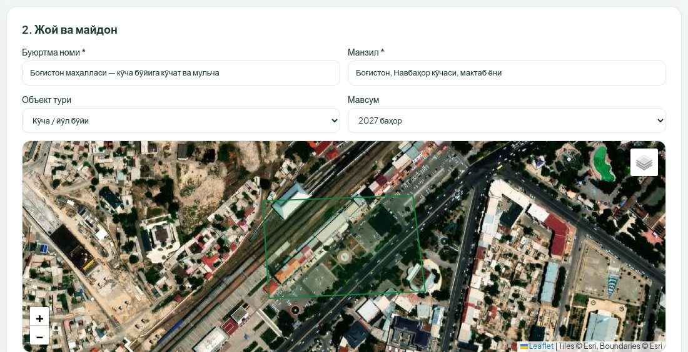

### 4.3. Маҳсулот ёки хизмат

1. **+ Маҳсулот қўшиш** ни босинг.
2. Рўйхатдан маҳсулотни танланг ва **Миқдор** ни киритинг (ўлчов бирлиги майдон ичида ёзилади: туп, кг, дона …).
3. Керакли сатрларни шу тарзда қўшинг. Ортиқча сатрни **✕** билан ўчиринг.
4. Мульча ёки ўғит танланса, **Асос кўчатлар сони** * пайдо бўлади. Меъёр: биогумус 5 кг/туп, мульча 4 кг/туп гача — асос кўчатлар сонига нисбатан. Меъёрдан ошса, юборишда хато чиқади.
5. ДМ хизмати танланса, **Хизмат учун муаммо тавсифи** * ни ёзинг.

### 4.4. Қўшимча маълумот ва иловалар

1. Зарур бўлса **Сув манбаи**, **Алоқа шахси**, **Қўшимча маълумот** ни тўлдиринг.
2. **Иловалар** — жой расми ёки ҳужжат (JPG, PNG, PDF; ҳар файл 10 МБ гача, жами 50 МБ гача). Файл танланганда буюртма ўзи қоралама сифатида сақланади. Файлни **Ўчириш** билан олиб ташлаш мумкин.
3. Пастдаги тугмалар:
   - **Бекор қилиш** — сақламасдан чиқиш;
   - **Қоралама сақлаш** — буюртмани қоралама сифатида сақлаш (рақам берилади, кейин давом эттириш мумкин);
   - **Буюртмани юбориш** — фақат имзоловчи ҳуқуқи бўлса кўринади: буюртмани сақлаб, имзо ойнасини очади (5-бўлим).

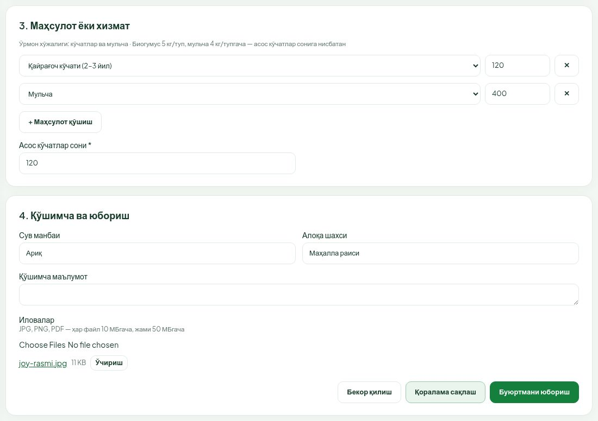

Хато бўлса, тегишли майдон остида қизил ёзув ва экран бурчагида хабар чиқади.

### 4.5. Қораламалар

Сақланган қораламалар **Буюртмалар → Қоралама** рўйхатида туради. Қораламани фақат маҳалланинг ўзи кўради — уюшма ва етказиб берувчига у кўринмайди.

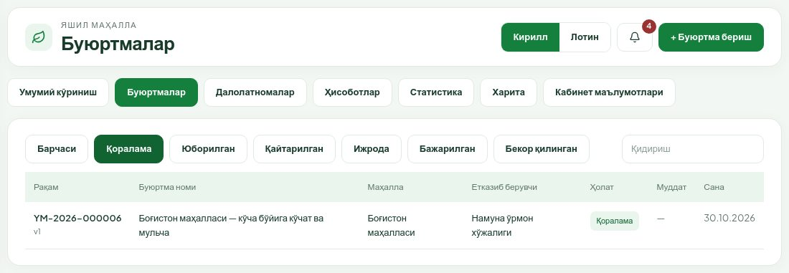

Қораламани очиб, **Таҳрирлаш** билан давом эттиринг ёки **Буюртмани бекор қилиш** билан бекор қилинг (8-бўлим).

## 5. Имзолаб юбориш

Буни имзоловчи бажаради. Компьютерда E-IMZO дастури ишлаб турган ва калитингиз (ёки USB-токен) уланган бўлиши керак.

1. Буюртмани очинг ва **Имзолаб юбориш** ни босинг (ёки шаклда **Буюртмани юбориш** ни).
2. «**Буюртманомани имзолаш**» ойнаси очилади. Тизим ҳужжатни тайёрлайди ва уни ойнада кўрсатади: буюртманома матни, маҳсулотлар жадвали ва QR код. **Имзолашдан олдин матнни охиригача ўқиб чиқинг** — айнан шу матн имзоланади.
3. Имзо усулини танланг:
   - **E-IMZO калит** — **Сертификатни танланг** рўйхатидан ўз калитингизни танланг (муддати ўтган калит «муддати ўтган» деб белгиланган ва танланмайди);
   - **USB-токен** — токенни уланг.
4. **Имзолаш ва юбориш** ни босинг. E-IMZO ўз ойнасида калит паролини (PIN) сўрайди — уни киритинг.
5. «**Буюртма имзоланди ва уюшмага юборилди**» хабари чиқади. Буюртма ҳолати — **Уюшмада янги**, кўриб чиқиш муддати бошланади.

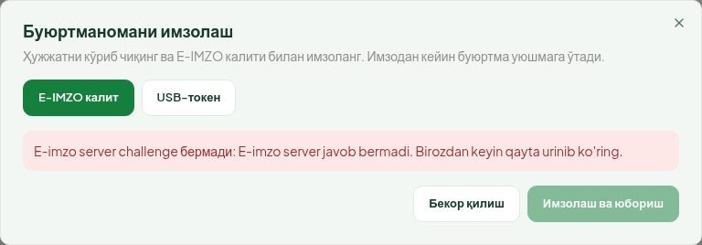

Расмда компьютерда E-IMZO ишламаётгани учун ойна хато кўрсатмоқда ва **Имзолаш ва юбориш** тугмаси ўчиқ. E-IMZO ишга туширилгач, ойнани ёпиб қайта очинг.

Эътибор беринг:

- Имзо фақат **сизнинг ўз калитингиз** билан қабул қилинади: сертификатдаги ПИНФЛ тизимдаги профилингиз ПИНФЛига мос бўлиши керак.
- Маҳаллага уюшма бўлинмаси бириктирилмаган бўлса, буюртма юборилмайди — маъмурга мурожаат қилинг.
- Юборилгандан кейин буюртмани маҳалла ўзгартира олмайди. Уни фақат уюшма ёки етказиб берувчи тузатиш учун қайтариши мумкин.

## 6. Буюртма карточкаси

Буюртмани очганда:

- юқорида босқичлар тасмаси;
- сарлавҳада ҳолат, версия, муддат ва амал тугмалари (тугмалар ҳолатга ва ҳуқуқингизга қараб ўзгаради);
- маҳалла, етказиб берувчи, уюшма бўлинмаси, манзил, нуқта, майдон ва бошқа маълумотлар;
- **Жойлашув нуқтаси** харитаси ва **Маҳсулот ва хизматлар** жадвали;
- ижрога қабулдан кейин — **Далолатномалар** рўйхати;
- **Ҳужжатлар** ва **Жараён журнали** ([умумий қўлланма](qollanma-umumiy.md), 8-бўлим).

## 7. Қайтарилган буюртмани тузатиш

Уюшма ёки етказиб берувчи буюртмани қайтарса, хабарнома келади ва буюртма **Буюртмалар → Қайтарилган** рўйхатига тушади.

1. Буюртмани очинг. Юқорида сариқ ҳошияли ёзувда **ким қайтаргани** («Уюшма қайтарди» ёки «Етказиб берувчи қайтарди»), сабаб тури, вақти ва изоҳ ёзилган.
2. Тайёрловчи **Таҳрирлаш** ни босади. Шакл юқорисида ҳам қайтариш изоҳи кўринади.
3. Изоҳда кўрсатилган камчиликни тузатинг ва **Қоралама сақлаш** ни босинг.
4. Имзоловчи **Имзолаб юбориш** ни босади ва 5-бўлимдаги каби қайта имзолайди.

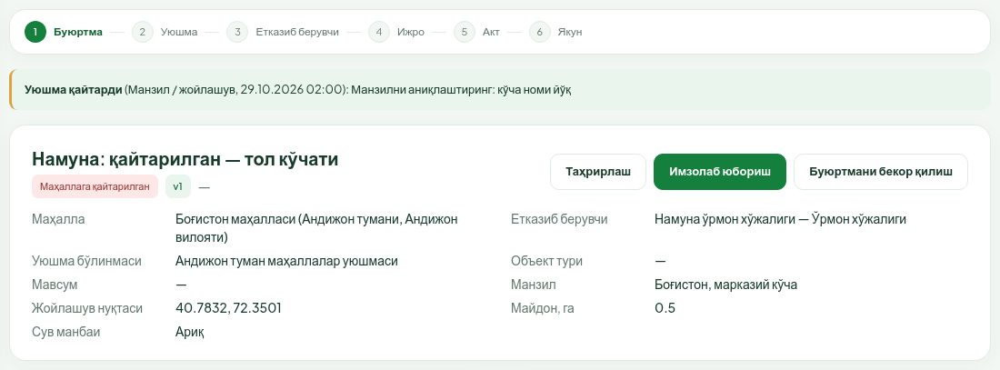

Қайта юборилганда буюртманинг янги версияси (v2, v3 …) ва янги буюртманома яратилади. Эски буюртманома «Алмаштирилган» бўлиб сақланади. Маҳаллада тузатишда турган кунлар кўриб чиқиш муддатига қўшилмайди, лекин аввал сарфланган кунлар сақланиб қолади.

## 8. Буюртмани бекор қилиш

### 8.1. Қоралама ёки қайтарилган буюртма

1. Буюртмани очинг ва **Буюртмани бекор қилиш** ни босинг.
2. **Сабаб (мажбурий)** ни ёзинг.
3. **Тасдиқлаш** ни босинг. Ойнадаги **Бекор қилиш** тугмаси эса ҳеч нарса қилмасдан ойнани ёпади.

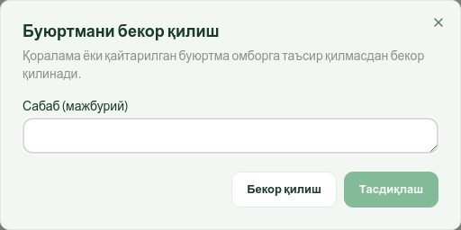

Бундай бекор қилиш омборга таъсир қилмайди. Буюртма уюшмада ёки етказиб берувчида кўриб чиқилаётганда маҳалла уни бекор қила олмайди — керак бўлса, уюшмадан буюртмани қайтаришни сўранг.

### 8.2. Ижродаги ёки қисман бажарилган буюртма

Ижрога қабулдан кейин буюртма фақат икки томон келишуви ва уюшма тасдиғи билан бекор қилинади.

1. Буюртмани очинг ва **Бекор қилиш сўрови** ни босинг.
2. Танланг:
   - **Бутун қолдиқни бекор қилиш** — етказилмаган барча қисм;
   - **Қисман (сатрлар бўйича)** — ҳар бир сатр учун бекор қилинадиган миқдорни киритинг (**Қолган** дан ошмаслиги керак).
3. **Сабаб (мажбурий)** ни ёзинг ва **Сўров юбориш** ни босинг.

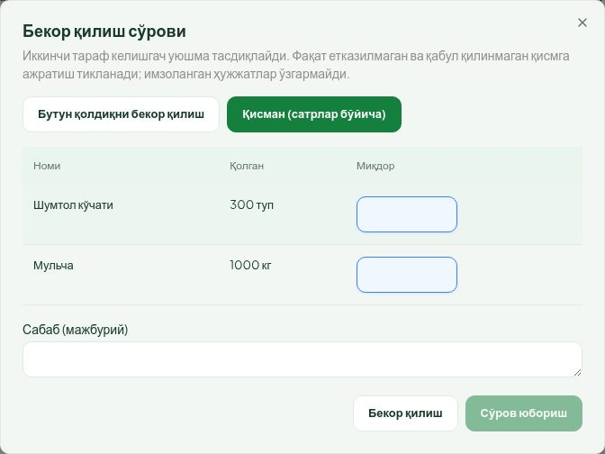

Кейин: етказиб берувчи розилик беради ёки рад этади, розилик бўлса уюшма тасдиқлайди ёки рад этади. Ҳар қадамда хабарнома келади, буюртма карточкасида «**Бекор қилиш сўрови**» картаси ва унинг ҳолати («Сўралган», «Иккинчи тараф келишган») кўринади. Тасдиқлангач, бекор қилиш ҳужжати яратилади; аввал имзоланган ҳужжатлар ва қабул қилинган миқдор ўзгармайди.

Сўров юбориб бўлмайди, агар буюртмада очиқ далолатнома ёки бошқа кўриб чиқилаётган сўров бўлса.

Агар сўровни **етказиб берувчи** юборган бўлса, маҳаллада (тайёрловчида) **Бекор қилишга розилик** ва **Бекор қилишни рад этиш** тугмалари чиқади. Розилик — **Тасдиқлаш** билан, рад этиш — сабаб ёзиб **Рад этиш** билан.

## 9. Далолатномани қабул қилиш

Етказиб берувчи маҳсулотни етказгач, далолатнома тузади, расм ёки PDF илова қилади, имзолайди ва маҳаллага юборади. Сизга «**Далолатнома … тасдиқ учун юборилди**» хабарномаси келади.

1. **Далолатномалар** бўлимини очинг — **Тасдиқ кутаётган** рўйхатида янги акт туради. Ёки хабарномадан буюртмага ўтиб, **Далолатномалар** жадвалидан актни очинг.
2. Текширинг:
   - **Маҳсулот ва хизматлар**: **Буюртма** устуни — буюртма қилинган, **Ушбу акт бўйича** — шу актда етказилган миқдор;
   - **Ҳақиқий етказиш санаси**, **Масъул шахс**, **Етказиш манзили**;
   - **Етказишни тасдиқловчи ҳужжатлар** — файлларни очиб кўринг;
   - **Ҳужжатлар** блокида **Кўриш** — далолатнома матни ва етказиб берувчи имзоси («Иккинчи имзо кутилмоқда»).

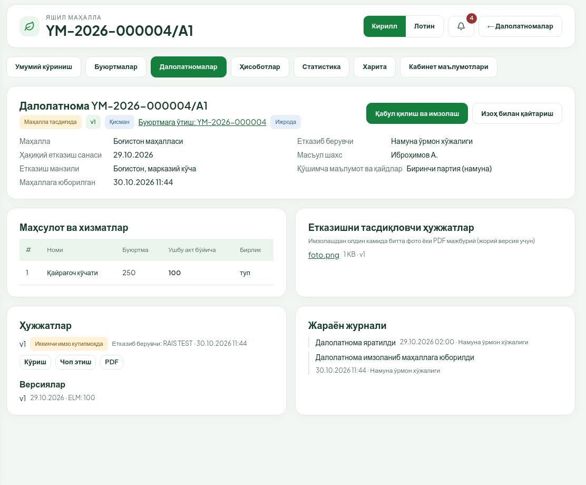

### 9.1. Қабул қилиш (имзоловчи)

1. **Қабул қилиш ва имзолаш** ни босинг.
2. «**Далолатномани имзолаш**» ойнасида ҳужжатни кўриб чиқинг. Айнан етказиб берувчи имзолаган версия имзоланади.
3. Калитни танланг ва **Қабул қилиш ва имзолаш** ни босинг, E-IMZO ойнасида PIN ни киритинг.
4. «**Далолатнома имзоланди**» хабари чиқади. Актдаги миқдорлар қабул қилинган деб ҳисобланади.

### 9.2. Қайтариш

Миқдор, сифат ёки ҳужжатда камчилик бўлса:

1. **Изоҳ билан қайтариш** ни босинг.
2. **Сабаб тури** ни танланг: «Ҳужжат хатоси», «Миқдор фарқи», «Сифат», «Амалда етказилмаган», «Бошқа».
3. **Изоҳ (мажбурий)** — нимани тузатиш кераклигини аниқ ёзинг.
4. Ойнадаги **Изоҳ билан қайтариш** тугмасини босинг.

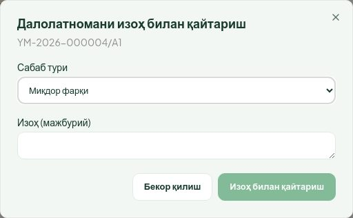

Акт етказиб берувчига «Тузатиш учун қайтарилган» бўлиб қайтади. У тузатиб, янги версияни имзолаб қайта юборади. Маҳалла актни ўзи таҳрирлай олмайди. Акт қайтарилганда етказиш муддати тўхтамайди.

## 10. Қисман етказиш

Етказиб берувчи буюртмани бир неча партияда етказиши мумкин — ҳар партия учун алоҳида акт (рақами буюртма рақами + /A1, /A2 …).

- Биринчи акт қабул қилингач, буюртма **Қисман бажарилган** ҳолатига ўтади.
- Буюртма карточкасидаги жадвалда **Қабул қилинган** ва **Қолган** устунлари пайдо бўлади.
- **Далолатномалар** жадвалида ҳар бир акт, унинг ҳолати ва «Қисман» белгиси кўринади. Актни очиш — **Кўриш**.
- Барча миқдор қабул қилингач, буюртма **Бажарилган** бўлади.

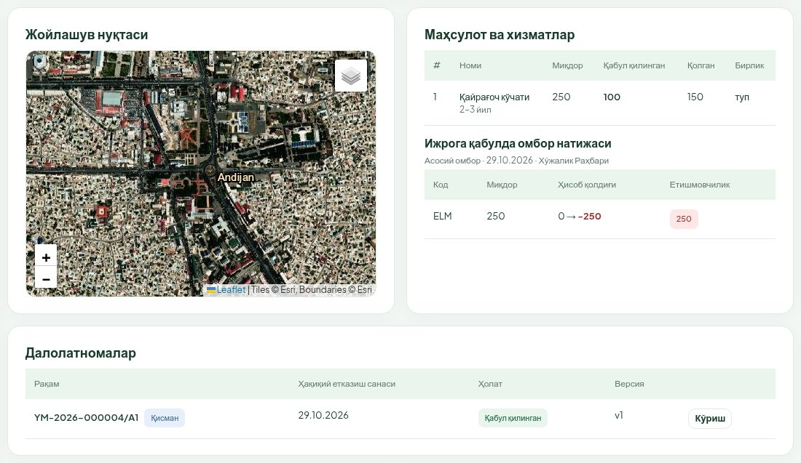

Бир вақтда фақат битта очиқ акт бўлиши мумкин: кейинги акт олдингиси қабул қилинган ёки бекор қилинганидан кейин тузилади.

## 11. Ҳисоботлар, статистика ва харита

Маҳалла фақат ўз маҳалласининг буюртмаларини кўради, қораламалар бу бўлимларга кирмайди.

**Ҳисоботлар**:

1. Юқори ўнгда реестрни танланг: **Буюртмалар реестри** ёки **Далолатномалар реестри**.
2. Йўналиш: **Умумий**, **Ўрмон хўжаликлари**, **Яшил боғлар ДМ**.
3. Фильтрлар: **Давр асоси** (буюртма юборилган сана, ижрога қабул санаси, ҳақиқий етказиш санаси), **дан** / **гача**, **Етказиб берувчи**, **Маҳсулот / хизмат**, **Ҳолат**, **Қидириш**, **Фақат муддати бузилган**.
4. **Устунлар** — жадвалда кўринадиган устунларни танлаш.
5. Юклаб олиш: **XLSX юклаш**, **CSV юклаш**, **PDF (чоп этиш)**. Экспорт экрандаги саҳифани эмас, бутун фильтрланган натижани олади. Катта ҳисобот навбатга қўйилади — тайёр бўлганда хабарнома келади ва файл юкланади.

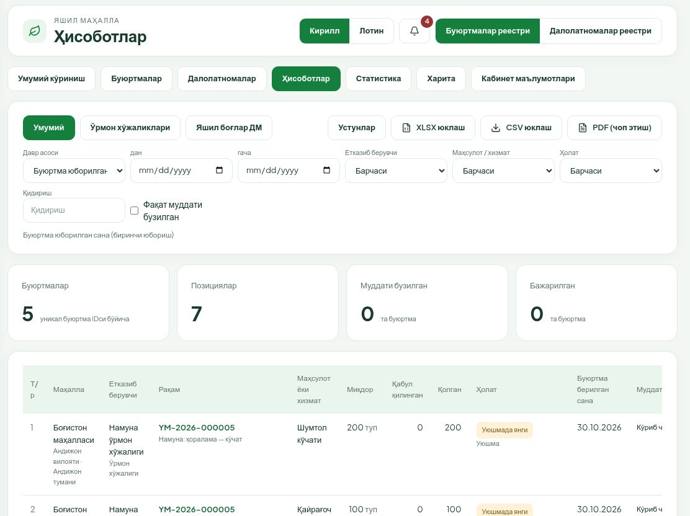

**Статистика** — буюртмалар карточкалари (янги, кўриб чиқилаётган, ижрода, бажарилган, қайтарилган, бекор қилинган, муддати бузилган), «**Кўчатлар бўйича фарқ**» (буюртма қилинган ва икки томон тасдиқлаган етказиш ўртасидаги фарқ) ва «**Орқада қолаётган ташкилотлар**».

**Харита** — ижрога қабул қилинган, қисман бажарилган ва бажарилган буюртмалар нуқталари. Бир манзилдаги буюртмалар гуруҳ бўлиб кўринади, гуруҳни босганда рўйхат очилади; **Карточкани очиш** — буюртмага ўтиш. **Фақат кўринаётган ҳудуд** белгиланса, рўйхат харитадаги кўриниб турган жой билан чекланади.

## 12. Кабинет маълумотлари

**Кабинет маълумотлари** бўлимида:

- маҳаллангиз, вилоят ва туман, лавозимингиз, алоқа рақами ва ҳуқуқларингиз («Ҳужжат тайёрлайди», «Имзолайди»);
- **Асосий ўрмон хўжалиги**, **Бошқа хўжаликлар**, ДМ лар ва **Уюшма бўлинмаси**;
- **Каталог** — буюртма қилиш мумкин бўлган маҳсулот ва хизматлар (нархсиз);
- **Ишлаб чиқариш календари** — дам олиш, байрам ва кўчирилган иш кунлари.

Бу маълумотларни маҳалла ўзгартира олмайди. Хато бўлса, модул маъмурига мурожаат қилинг.
