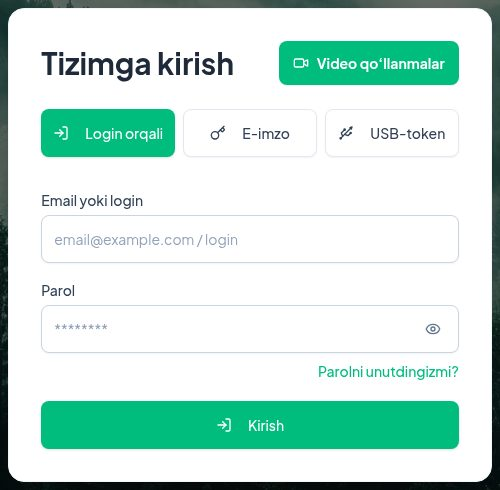
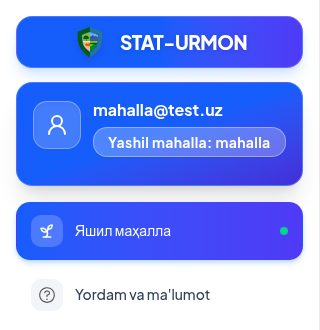
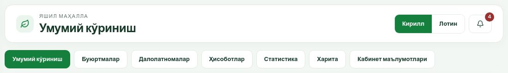
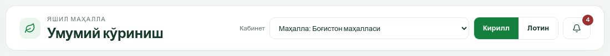
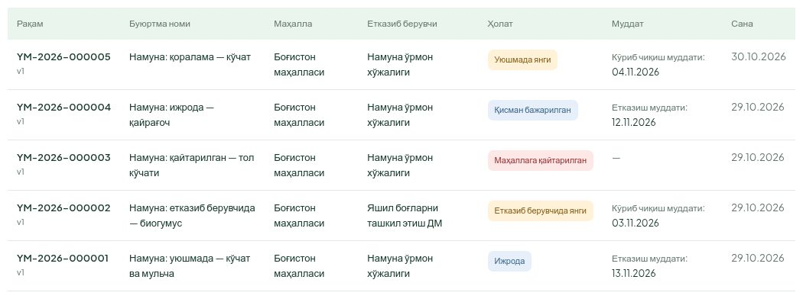
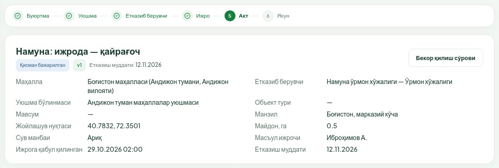
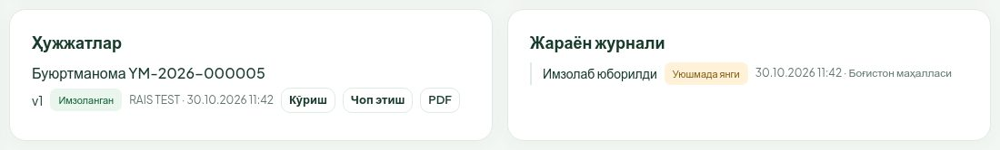
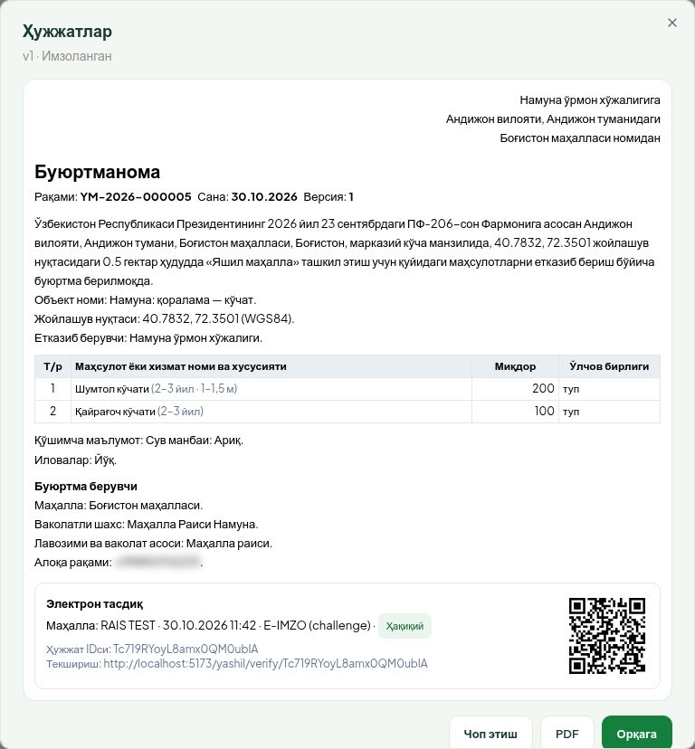
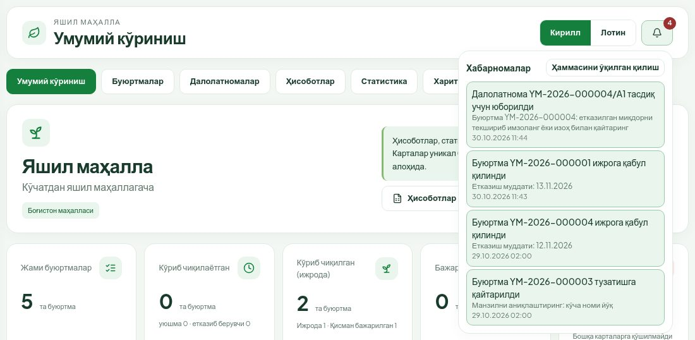
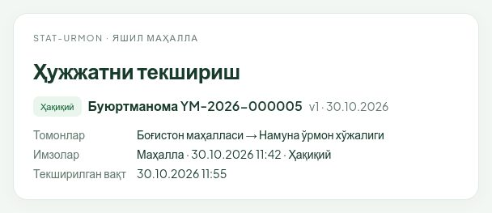

# «Яшил маҳалла» модули: умумий қўлланма

**Кимлар учун.** STAT-URMON тизимидаги «Яшил маҳалла» модулида ишлайдиган барча фойдаланувчилар учун: маҳалла, маҳаллалар уюшмаси, етказиб берувчи (ўрмон хўжалиги, ДМ), агентлик кузатувчиси ва модул маъмури. Бу ерда ҳамма учун бир хил бўлган қисмлар тушунтирилади. Ҳар бир роль учун алоҳида қўлланма охирида келтирилган.

---

## 1. Модул нима учун

«Яшил маҳалла» — маҳаллаларни кўкаламзорлаштириш учун кўчат, мульча, органик ўғит, суғориш воситалари ва ҳимоя хизматига буюртма бериш ва уни охиригача кузатиш тизими. Маҳалла буюртмани электрон шаклда тузади ва E-IMZO билан имзолайди, маҳаллалар уюшмаси уни текшириб етказиб берувчига йўллайди, етказиб берувчи ижрога қабул қилади ва етказилганини далолатнома (акт) билан расмийлаштиради, маҳалла актни имзолаб қабул қилади. Ҳар бир қадам, муддат ва имзо журналда сақланади, имзоланган ҳужжатни QR код орқали ҳар ким текшира олади.

## 2. Тизимга кириш

1. Браузерда **stat-urmon.uz** манзилини очинг.
2. **Login orqali** бўлимида **Email yoki login** ва **Parol** майдонларига логин ва паролингизни киритинг.
3. **Kirish** тугмасини босинг.

Ўша ойнада **E-imzo** ва **USB-token** орқали кириш ҳам бор. Паролни унутган бўлсангиз — **Parolni unutdingizmi?** ҳаволаси.

## 3. «Яшил маҳалла» бўлимини очиш

Тизимга кирганингиздан кейин чап менюда **Яшил маҳалла** бандини босинг.

- Фақат шу модул учун берилган ҳисобларда (маҳалла, уюшма, ДМ, кузатувчи) чап менюда фақат **Яшил маҳалла** ва ёрдам бўлими кўринади.
- Ўрмон хўжалиги ходимлари STAT-URMON нинг бошқа бўлимлари қаторида **Яшил маҳалла** бандини ҳам кўради.
- Агар «**Сиз модулга бириктирилмагансиз**» деган ёзув чиқса — сизга ҳали кабинет берилмаган. Модул маъмурига мурожаат қилинг: у сизни маҳалла, уюшма, етказиб берувчи ёки кузатувчи сифатида бириктиради.

## 4. Модул сарлавҳаси ва бўлимлар

Ҳар бир саҳифанинг юқорисида модул сарлавҳаси ва бўлимлар қатори туради.

Сарлавҳада:

- чапда — модул номи ва жорий саҳифа номи (буюртма ичида — буюртма рақами);
- **Кирилл / Лотин** — модул саҳифаларини кирилл ёки лотин ёзувида кўрсатади. Танлов браузерда сақланади ва фақат шу модулга таъсир қилади. Имзоланадиган ҳужжатлар матни ҳар доим кириллда;
- қўнғироқ белгиси — хабарномалар, ёнидаги қизил рақам — ўқилмаганлар сони (9-бўлим);
- саҳифага хос тугмалар, масалан **+ Буюртма бериш** ёки **← Буюртмалар** (рўйхатга қайтиш).

Бўлимлар қатори (кабинетга қараб бир қисми кўринмаслиги мумкин):

| Бўлим | Нима бор |
|---|---|
| **Умумий кўриниш** | Кабинет бўйича асосий рақамлар, муддат қоидалари |
| **Буюртмалар** | Буюртмалар рўйхати ва карточкалари |
| **Далолатномалар** | Етказиш актлари рўйхати |
| **Омбор** | Фақат етказиб берувчи ва кузатувчида: қолдиқлар ва ҳаракатлар |
| **Ҳисоботлар** | Буюртмалар ва далолатномалар реестри, экспорт |
| **Статистика** | Карточкалар, кўчатлар бўйича фарқ, орқада қолаётган ташкилотлар |
| **Харита** | Ижрога қабул қилинган буюртмалар нуқталари |
| **Кабинет маълумотлари** | Сизнинг ташкилотингиз, ҳуқуқларингиз, бириктирилган етказиб берувчилар, каталог, иш календари |
| **Маъмурият** | Фақат модул маъмурида |

Ҳар бир кабинет фақат ўз ваколати доирасидаги маълумотни кўради: маҳалла — ўз маҳалласини, уюшма — ўз бўлинмасига келган буюртмаларни, етказиб берувчи — ўз ташкилотига йўлланганларни, кузатувчи — ўз ҳудудини.

## 5. Кабинетни алмаштириш

Битта фойдаланувчи бир нечта ташкилот номидан ишлаши мумкин (масалан, маҳаллада ва кузатувчи сифатида). Шундай ҳолда сарлавҳада **Кабинет** рўйхати пайдо бўлади.

1. **Кабинет** рўйхатини очинг.
2. Керакли кабинетни танланг (олдида тури ёзилган: «Маҳалла: …», «Маҳаллалар уюшмаси: …» ва ҳоказо).
3. Саҳифадаги барча маълумот танланган кабинет бўйича қайта юкланади.

Барча амаллар (имзо, қайтариш, қабул) **жорий кабинет номидан** бажарилади. Амал бажаришдан олдин тўғри кабинет танланганини текширинг. Кабинет битта бўлса, бу рўйхат кўринмайди.

## 6. Буюртма ҳолатлари

Ҳар бир буюртманинг ҳолати рангли белги ва матн билан кўрсатилади.

| Ҳолат | Маъноси | Ким кутилмоқда |
|---|---|---|
| **Қоралама** | Маҳалла тузмоқда, ҳали юборилмаган. Фақат маҳаллага кўринади | Маҳалла |
| **Уюшмада янги** | Маҳалла имзолаб юборди | Уюшма |
| **Уюшма кўриб чиқмоқда** | Уюшма текширишни бошлади | Уюшма |
| **Маҳаллага қайтарилган** | Уюшма ёки етказиб берувчи тузатиш учун қайтарди | Маҳалла |
| **Етказиб берувчида янги** | Уюшма етказиб берувчига йўллади | Етказиб берувчи |
| **Етказиб берувчи кўриб чиқмоқда** | Етказиб берувчи текширмоқда | Етказиб берувчи |
| **Ижрода** | Етказиб берувчи ижрога қабул қилди, етказиш муддати бошланди | Етказиб берувчи |
| **Қисман бажарилган** | Бир қисми акт билан қабул қилинган, қолгани етказилмоқда | Етказиб берувчи |
| **Бажарилган** | Барча миқдор акт билан қабул қилинган | — |
| **Бекор қилинган** | Буюртма бекор қилинган | — |

Ранглар: сариқ — кўриб чиқиш кутилмоқда; қизил — қайтарилган ёки бекор қилинган; кўк — ижро ва қисман бажарилган; оч яшил — қоралама ва бажарилган. Ҳолат ҳар доим матн билан ҳам ёзилади.

### Босқичлар тасмаси

Буюртма карточкасининг юқорисида олти босқичли тасма бор: **Буюртма → Уюшма → Етказиб берувчи → Ижро → Акт → Якун**.

- Ўтилган босқичлар белги (✓) билан, жорий босқич яшил доирада рақам билан кўрсатилади.
- Қайтарилган буюртма 1-босқичда («Буюртма») туради.
- Ижрода очиқ акт бўлса ёки буюртма қисман бажарилган бўлса — 5-босқич («Акт»).
- Бекор қилинган буюртмада охирги босқич қизил белги билан кўрсатилади.

## 7. Муддатлар

Муддатлар **иш кунларида** ҳисобланади. Дам олиш ва байрам кунлари, кўчирилган иш кунлари **Кабинет маълумотлари → Ишлаб чиқариш календари** да кўрсатилган.

| Муддат | Қачондан | Қачонгача | Изоҳ |
|---|---|---|---|
| **3 иш куни — кўриб чиқиш** | Маҳалла буюртмани биринчи марта имзолаб юборган кундан | Етказиб берувчи ижрога қабул қилгунча | Уюшма ва етказиб берувчи учун **жами** 3 кун (ҳар бирига алоҳида эмас). Буюртма маҳаллада тузатишда турган кунлар ҳисобга кирмайди, аммо аввал сарфланган кунлар нолга қайтмайди |
| **10 иш куни — етказиш** | Ижрога қабул қилинган кундан | Барча миқдор етказилгунча | Акт қайтарилганда ҳам тўхтамайди |

Қаерда кўринади:

- **Умумий кўриниш** даги «**Муддат қоидалари**» картасида — бугун юборилган буюртма учун қайси санагача муддат борлиги;
- рўйхатнинг **Муддат** устунида ва буюртма карточкасида — «**Кўриб чиқиш муддати: …**» ёки «**Етказиш муддати: …**»;
- кўриб чиқиш босқичида карточкада «**N / 3 сарфланди**» — нечта иш куни ишлатилгани;
- муддат ўтса — қизил белги «**N иш куни кечиккан**». Бу белги ҳолатни алмаштирмайди, ёнига қўшилади.

Эслатмалар хабарнома орқали келади: кўриб чиқиш муддатига 1 иш куни қолганда, етказиш муддатига 3 ва 1 иш куни қолганда — масъул кабинетга. Муддат бузилса, ҳар иш куни бир марта масъулга, етказишда эса маҳаллага ва кузатувчиларга ҳам хабар боради.

## 8. Ҳужжатлар блоки

Буюртма ва далолатнома карточкасининг пастида **Ҳужжатлар** ва **Жараён журнали** блоклари бор.

**Ҳужжатлар** блокида ҳужжат тури ва рақами (Буюртманома, Далолатнома, Бекор қилиш ҳужжати), ҳар бир версия (v1, v2 …), унинг ҳолати ва имзолар (имзоловчи, сана, вақт) кўрсатилади. Ҳужжат ҳолатлари:

- **Имзоланмаган** — ҳужжат тайёрланган, имзо қўйилмаган;
- **Иккинчи имзо кутилмоқда** — далолатномада етказиб берувчи имзолаган, маҳалла имзоси кутилмоқда;
- **Имзоланган** — барча зарур имзолар бор;
- **Алмаштирилган** — бу эски версия, кейин янги версия имзоланган (масалан, қайтарилган буюртма қайта юборилганда);
- **Бекор қилинган**.

Ҳар бир версия ёнида учта тугма:

1. **Кўриш** — ҳужжатни ойнада очади: тўлиқ матн, жадвал, «Электрон тасдиқ» блоки ва QR код. Ойнадан ҳам **Чоп этиш**, **PDF** қилиш мумкин; **Орқага** — ёпиш.
2. **Чоп этиш** — ҳужжатни чоп этишга мос кўринишда янги варақда очади.
3. **PDF** — ҳужжатнинг PDF нусхасини очади.

**Жараён журнали** — буюртма билан бўлган барча амаллар: ким, қачон, қайси ҳолатга ўтказгани, қайтариш ва рад этиш сабаблари. Журнални ўзгартириб ҳам, ўчириб ҳам бўлмайди.

## 9. Хабарномалар

1. Сарлавҳадаги қўнғироқ белгисини босинг — охирги 20 та хабарнома очилади. Ўқилмаганлари яшил ҳошияда.
2. Хабарномани босинг — у ўқилган деб белгиланади ва тегишли буюртма карточкаси очилади.
3. **Ҳаммасини ўқилган қилиш** — барча хабарномани бирданига ўқилган қилади.

Хабарнома келадиган ҳолатлар: янги буюртма (уюшмага, етказиб берувчига), буюртма қайтарилди, ижрога қабул қилинди, далолатнома тасдиққа юборилди / қабул қилинди / қайтарилди, бекор қилиш сўрови ва унинг натижаси, муддат эслатмаси ва бузилиши, экспорт тайёр бўлди.

## 10. QR код орқали ҳужжатни текшириш

Ҳар бир имзоланадиган ҳужжатда QR код ва «Текшириш» ҳаволаси бор. Уни телефон камераси билан ўқиш ёки ҳаволани браузерда очиш кифоя. **Тизимга кириш шарт эмас.**

Саҳифада фақат қуйидагилар кўрсатилади (шахсий маълумот чиқмайди): текшириш натижаси, ҳужжат тури ва рақами, версияси ва санаси, томонлар (маҳалла → етказиб берувчи), имзолар (қайси тараф, қачон, ҳақиқийми), етишмаётган имзо ва текширилган вақт.

| Натижа | Маъноси |
|---|---|
| **Ҳақиқий** | Ҳужжат тизимда бор, имзолар тўғри, мазмуни имзодан кейин ўзгармаган |
| **Имзо кутилмоқда** | Ҳужжат ҳали тўлиқ имзоланмаган; «Етишмаётган имзо» қаторида ким имзолаши кераклиги ёзилади |
| **Алмаштирилган (эски версия)** | Бу ҳужжатнинг эски версияси, унинг ўрнига янгиси имзоланган. Амалда янги версия ишлатилади |
| **Бекор қилинган** | Ҳужжат бекор қилинган |
| **Ҳақиқий эмас: ҳужжат мазмуни имзодан кейин ўзгартирилган** | Сақланган мазмун имзоланган мазмунга мос келмайди. Бундай ҳужжатга ишонманг ва модул маъмурига хабар беринг |
| **Ҳужжат топилмади** | QR код нотўғри ёки ҳужжат тизимда йўқ |

## 11. Кўп учрайдиган хабарлар ва нима қилиш керак

| Хабар | Сабаби | Нима қилиш керак |
|---|---|---|
| «**Буюртма бошқа фойдаланувчи томонидан ўзгартирилган — саҳифани янгиланг**» | Сиз саҳифани очиб турганингизда буюртмани бошқа ходим ўзгартирган ёки ҳолати ўзгарган | Саҳифани янгиланг (F5), ўзгаришни кўриб, амални қайта бажаринг |
| «**Имзоланаётган ҳужжат версияси жорий эмас — саҳифани янгиланг**» | Далолатноманинг янги версияси пайдо бўлган | Саҳифани янгиланг ва жорий версияни имзоланг |
| «**Объект топилмади ёки очиш ҳуқуқи йўқ**» | Буюртма ёки акт сизнинг кабинетингиз доирасида эмас | Тўғри кабинет танланганини текширинг (5-бўлим) |
| Керакли тугма кўринмайди | Бу амал сизнинг ҳуқуқингизда йўқ ёки ҳолат мос эмас (масалан, имзолаш ҳуқуқи фақат «Имзолайди» белгиси бор ходимда) | **Кабинет маълумотлари** да ҳуқуқларингизни кўринг; хато бўлса маъмурга мурожаат қилинг |
| «**Сиз модулга бириктирилмагансиз**» | Кабинет берилмаган ёки муддати тугаган | Модул маъмурига мурожаат қилинг |
| E-IMZO уланиш хатоси, «Сертификат топилмади» | E-IMZO дастури ўрнатилмаган ёки ишламаяпти, калит уланмаган | E-IMZO ни ишга туширинг, калит ёки USB-токенни уланг, саҳифани янгиланг |
| Имзо рад этилди (сертификат эгаси мос эмас) | Калит бошқа шахсники. Имзо фақат тизимга кирган фойдаланувчининг ўз калити билан қабул қилинади | Ўз калитингиз билан имзоланг |
| Файл юкланмади | Фақат JPG, PNG, PDF; ҳар файл 10 МБ гача, жами 50 МБ гача | Файл турини ва ҳажмини текширинг |
| «**Хатолик юз берди**» | Кутилмаган хато | Бироздан кейин қайта уриниб кўринг; такрорланса, вақтини ва буюртма рақамини ёзиб, ёрдам хизматига мурожаат қилинг |

## 12. Қисқа луғат

| Атама | Маъноси |
|---|---|
| **Кабинет** | Сиз қайси ташкилот номидан ишлаётганингиз (маҳалла, уюшма бўлинмаси, етказиб берувчи, кузатувчи) |
| **Тайёрловчи** («Ҳужжат тайёрлайди») | Буюртма ёки акт тузади, таҳрирлайди, файл қўшади |
| **Имзоловчи** («Имзолайди») | E-IMZO билан имзолайди. Бир ходимда иккала ҳуқуқ ҳам бўлиши мумкин |
| **Буюртманома** | Маҳалла имзолайдиган буюртма ҳужжати |
| **Далолатнома (акт)** | Етказилганини тасдиқловчи ҳужжат; етказиб берувчи ва маҳалла имзолайди |
| **Версия** | Ҳужжатнинг ҳар бир таҳрири; эски версия ўчирилмайди, «алмаштирилган» бўлиб қолади |
| **Уюшма бўлинмаси** | Маҳалланинг буюртмасини текширадиган маҳаллалар уюшмаси бўлими |
| **Асосий ўрмон хўжалиги** | Маҳаллага бириктирилган кўчат етказиб берувчи |
| **ДМ** | Яшил боғларни ташкил этиш ДМ — органик ўғит, ускуна, суғориш воситалари ва ҳимоя хизмати етказиб берувчи |
| **Иш куни** | Ишлаб чиқариш календари бўйича иш куни |
| **QR текшириш** | Ҳужжатнинг ҳақиқийлигини логинсиз текшириш саҳифаси |

## 13. Роллар бўйича қўлланмалар

- [Маҳалла кабинети](qollanma-mahalla.md) — буюртма тузиш, имзолаш, қайтарилганни тузатиш, актни қабул қилиш.
- [Маҳаллалар уюшмаси кабинети](qollanma-uyushma.md) — буюртмани текшириш, етказиб берувчига йўллаш, қайтариш, бекор қилишни тасдиқлаш.
- [Етказиб берувчи кабинети](qollanma-yetkazib-beruvchi.md) — ўрмон хўжалиги ва ДМ: ижрога қабул, омбор, далолатнома.
- [Агентлик кузатувчиси](qollanma-kuzatuvchi.md) — кўриш, ҳисобот ва назорат.
- [Модул маъмури](qollanma-maamur.md) — аъзоликлар, маълумотномалар, қоидалар, журнал.
