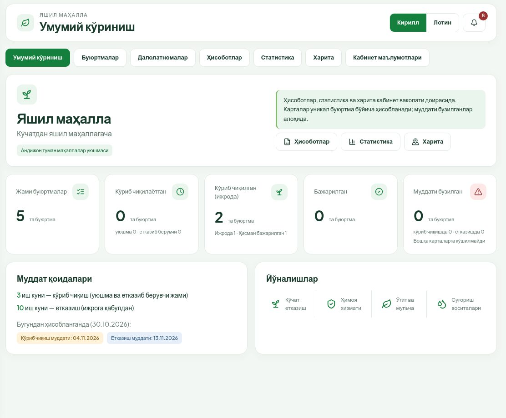
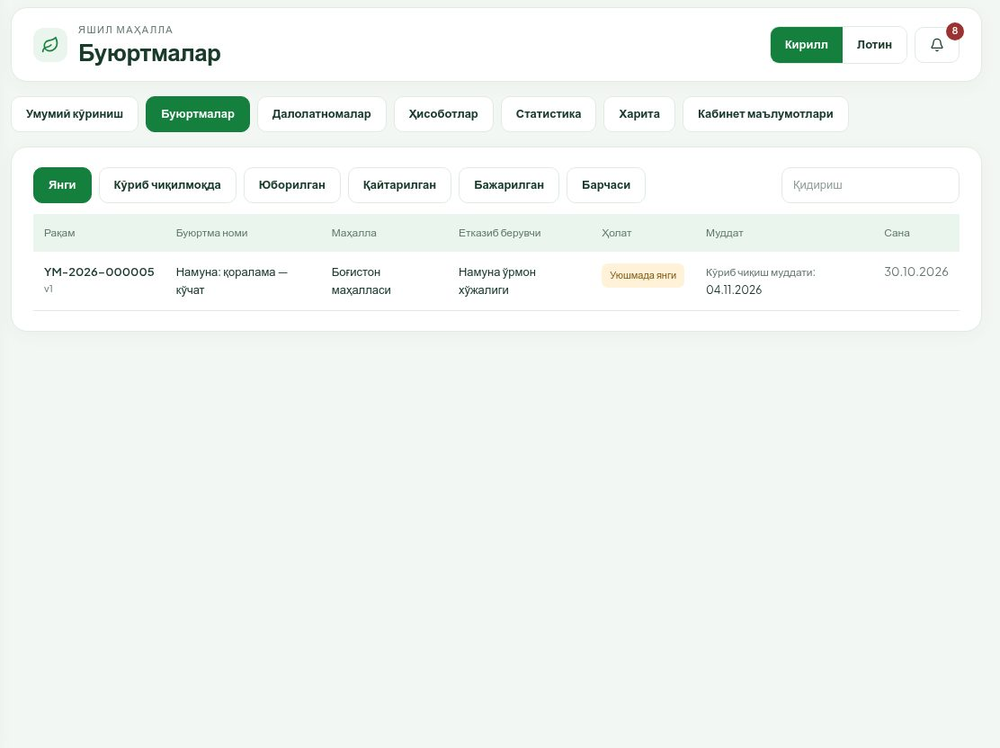
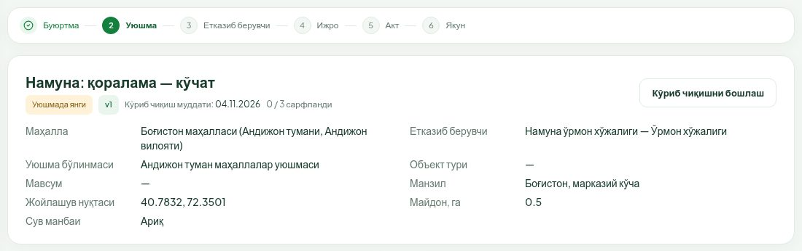
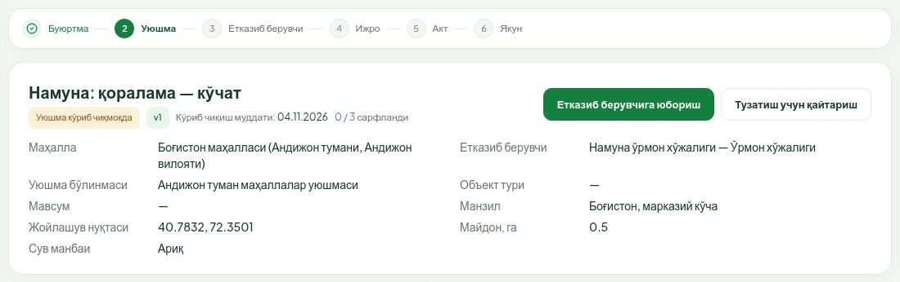
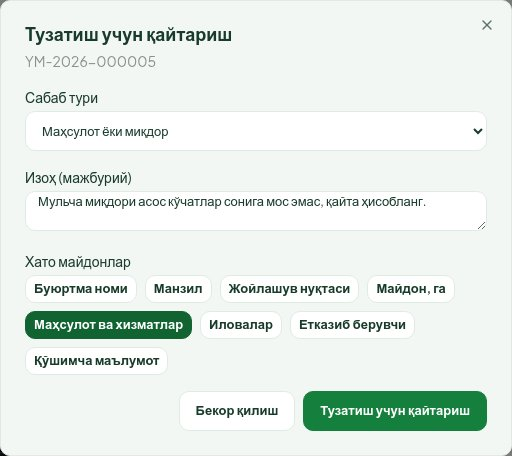
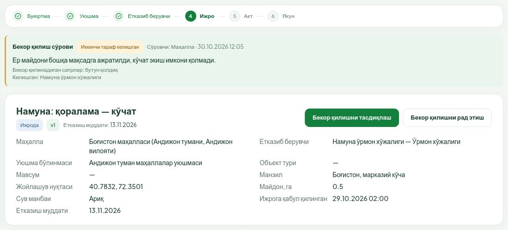
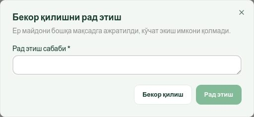
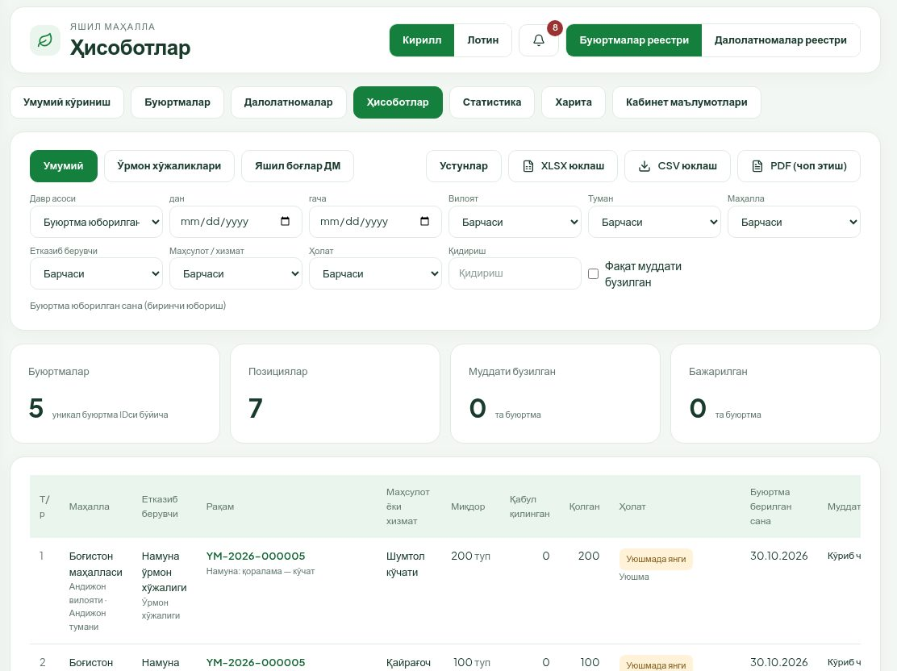
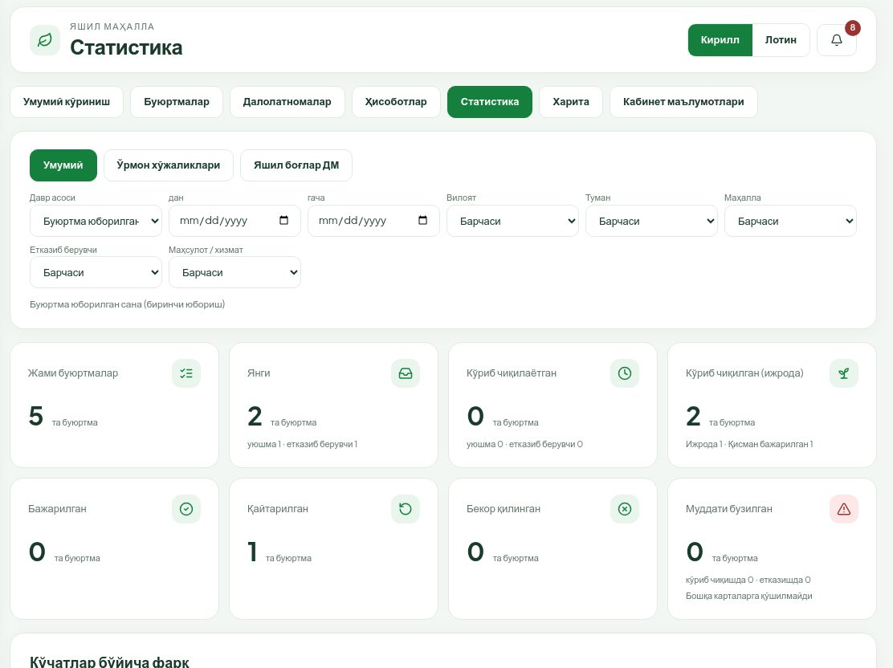

# «Яшил маҳалла»: маҳаллалар уюшмаси кабинети қўлланмаси

**Кимлар учун.** Маҳаллалар уюшмаси бўлинмаси ходимлари учун: маҳаллалардан келган буюртмаларни текшириш, етказиб берувчига йўллаш, тузатишга қайтариш ва бекор қилиш сўровларини ҳал қилиш. Тизимга кириш, ҳолатлар, муддатлар, ҳужжатлар ва QR текшириш [умумий қўлланмада](qollanma-umumiy.md) ёзилган — аввал уни ўқинг.

---

## 1. Уюшма нимани кўради ва нима қилади

- Уюшма бўлинмаси **ўзига йўналтирилган маҳаллалар** юборган буюртмаларни кўради. Буюртма қайси бўлинмага тушиши маҳалла имзолаб юборган пайтдаги бириктирувга қараб белгиланади.
- Маҳалла қораламалари уюшмага кўринмайди. Омбор маълумотлари ҳам кўринмайди.
- Уюшма буюртмани **текширади** ва иккита қарордан бирини қабул қилади: **етказиб берувчига йўллаш** ёки **маҳаллага тузатиш учун қайтариш**.
- Уюшма буюртма мазмунини (маҳсулот, миқдор, етказиб берувчи, жой) **ўзгартира олмайди** — бу маҳалла имзолаган ҳужжат. Камчилик бўлса, ягона йўл — сабаб ва изоҳ билан қайтариш.
- Уюшма E-IMZO билан имзо қўймайди. Уюшма ходимлари учун «тайёрловчи» ва «имзоловчи» фарқи йўқ — бўлинманинг ҳар бир ходими барча уюшма амалларини бажара олади.
- Далолатномаларни уюшма фақат кўради (қабул қилиш ёки қайтариш маҳалла ва етказиб берувчи иши).

## 2. Умумий кўриниш

Карточкалар бўлинмага келган буюртмалар бўйича ҳисобланади: **Жами буюртмалар**, **Кўриб чиқилаётган** (уюшмада ва етказиб берувчида), **Кўриб чиқилган (ижрода)**, **Бажарилган**, **Муддати бузилган**. Пастда — муддат қоидалари.

## 3. Янги буюртмалар рўйхати

1. **Буюртмалар** бўлимини очинг. Рўйхат **Янги** тугмаси билан очилади — шу ерда сиз кўриб чиқишингиз керак бўлган буюртмалар.
2. Бошқа рўйхатлар:
   - **Кўриб чиқилмоқда** — текшириш бошланган, қарор қабул қилинмаган;
   - **Юборилган** — етказиб берувчига йўлланган, ижрода ва қисман бажарилган;
   - **Қайтарилган** — маҳаллага тузатишга қайтарилган;
   - **Бажарилган**;
   - **Барчаси**.
3. **Қидириш** — рақам ёки ном бўйича.

Янги буюртма келганда хабарнома ҳам келади. **Муддат** устунида кўриб чиқиш охирги санаси кўрсатилади.

## 4. Буюртмани кўриб чиқиш

1. Рўйхатдан буюртмани очинг. Ҳолати — **Уюшмада янги**, босқичлар тасмасида жорий босқич — «Уюшма».
2. **Кўриб чиқишни бошлаш** ни босинг. Тасдиқлаш ойнаси чиқмайди: ҳолат дарҳол **Уюшма кўриб чиқмоқда** га ўтади, журналга «Кўриб чиқиш бошланди» ёзилади. Шу билан бошқа ходимлар ҳам буюртма текширилаётганини кўради.

3. Текширинг:
   - **Маҳалла**, **Етказиб берувчи**, **Манзил**, **Объект тури**, **Мавсум**, **Майдон, га**;
   - **Жойлашув нуқтаси** харитасида нуқта ва полигон тўғри жойдами;
   - **Маҳсулот ва хизматлар** жадвалида маҳсулот ва миқдорлар; мульча ва ўғит асос кўчатлар сонига мос келадими;
   - **Иловалар** — расм ва ҳужжатлар;
   - **Ҳужжатлар** блокида буюртманома: **Кўриш** билан матнни ва маҳалла имзосини кўринг («Имзоланган»).

## 5. Етказиб берувчига юбориш

Буюртма тўғри бўлса:

1. **Етказиб берувчига юбориш** ни босинг.
2. Тасдиқлаш ойнаси чиқмайди: буюртма дарҳол етказиб берувчига ўтади. Ҳолат — **Етказиб берувчида янги**, етказиб берувчига хабарнома боради.

Юборишда буюртманинг ҳеч бир маълумоти ўзгармайди — фақат ҳолати. Шунинг учун тугмани босишдан олдин текширишни тугатинг: юборилгандан кейин буюртма уюшмадан чиқади, уни қайтариш энди етказиб берувчининг ихтиёрида.

## 6. Маҳаллага тузатиш учун қайтариш

Камчилик бўлса:

1. **Тузатиш учун қайтариш** ни босинг.
2. **Сабаб тури** ни танланг: «Манзил / жойлашув», «Маҳсулот ёки миқдор», «Етказиб берувчи», «Ҳужжатлар / иловалар», «Меъёрлар», «Бошқа».
3. **Изоҳ (мажбурий)** — маҳалла нимани ва қандай тузатиши кераклигини аниқ ёзинг. Изоҳсиз қайтариб бўлмайди.
4. Хоҳласангиз, **Хато майдонлар** дан хатоли майдонларни белгиланг. Белгиланган майдонлар маҳаллага қайтариш сабаби ёнида кўрсатилади.
5. Ойнадаги **Тузатиш учун қайтариш** тугмасини босинг. **Бекор қилиш** — ҳеч нарса қилмасдан ёпиш.

Натижа: ҳолат **Маҳаллага қайтарилган**, маҳаллага хабарнома боради. Маҳалла тузатиб, қайта имзолаб юборгач, буюртма янги версия билан яна **Янги** рўйхатида пайдо бўлади — уни 4-бўлимдагидек қайта кўриб чиқинг.

Етказиб берувчи буюртмани маҳаллага қайтарса ҳам уюшмага хабарнома келади (сарлавҳасида «(етказиб берувчи)» деб ёзилади).

## 7. Муддат: 3 иш куни

- Кўриб чиқиш учун **уюшма ва етказиб берувчига жами 3 иш куни** берилади — маҳалла биринчи марта юборган кундан етказиб берувчи ижрога қабул қилгунча. Уюшма учун алоҳида 3 кун йўқ: уюшма қанча кўп вақт сарфласа, етказиб берувчига шунча кам қолади.
- Карточкада «**Кўриб чиқиш муддати: …**» ва «**N / 3 сарфланди**» кўрсатилади.
- Буюртма маҳаллада тузатишда турган кунлар ҳисобга кирмайди, аммо аввал сарфланган кунлар сақланади.
- Муддатга 1 иш куни қолганда эслатма келади. Муддат ўтса, ҳар иш куни хабарнома келади ва буюртмада қизил «**N иш куни кечиккан**» белгиси пайдо бўлади.
- Кечикиш айни пайтда ҳужжат кимда турган бўлса, ўшанга ёзилади. Уюшма бўлинмалари ҳам **Статистика → Орқада қолаётган ташкилотлар** жадвалида кўрсатилади.

## 8. Бекор қилиш сўровини ҳал қилиш

Ижрога қабул қилинган буюртмани маҳалла ёки етказиб берувчи бекор қилишни сўраши мумкин. Тартиб:

1. Бир томон (маҳалла ёки етказиб берувчи) сўров юборади — уюшмага хабарнома келади.
2. Иккинчи томон рози бўлади ёки рад этади.
3. Иккинчи томон рози бўлгач, **уюшма якуний қарорни қабул қилади**.

Буюртма карточкасида «**Бекор қилиш сўрови**» картаси кўринади: ҳолати («Сўралган» ёки «Иккинчи тараф келишган»), ким ва қачон сўрагани, сабаби, бекор қилинадиган сатрлар (ёки «бутун қолдиқ») ва ким келишгани. Уюшма тугмалари сўров ҳолати «**Иккинчи тараф келишган**» бўлганда чиқади.

### 8.1. Тасдиқлаш

1. **Бекор қилишни тасдиқлаш** ни босинг.
2. Ойнада сабаб ва бекор қилинадиган сатрларни яна бир бор текширинг.
3. **Тасдиқлаш** ни босинг.

Натижа: фақат ҳали етказилмаган ва қабул қилинмаган қисм бекор қилинади, бекор қилиш ҳужжати яратилади, маҳалла ва етказиб берувчига хабарнома боради. Аввал имзоланган ҳужжатлар ва қабул қилинган миқдор ўзгармайди. Бутун қолдиқ бекор қилинса, буюртма **Бекор қилинган** ҳолатига ўтади. Қисман бекор қилинганда буюртма миқдори камаяди: қолган барча миқдор аллақачон қабул қилинган бўлса — **Бажарилган**, бўлмаса буюртма ижрода давом этади.

Буюртмада очиқ (қабул қилинмаган) далолатнома бўлса, тизим тасдиқлашга йўл қўймайди — аввал акт якунланиши ёки бекор қилиниши керак.

### 8.2. Рад этиш

1. **Бекор қилишни рад этиш** ни босинг.
2. **Рад этиш сабаби** ни ёзинг (мажбурий).
3. **Рад этиш** ни босинг.

Сўров ёпилади, буюртма ижрода қолади, томонларга хабарнома боради.

Маҳалла қайтарилган буюртмасини ўзи бекор қилса (ижрогача), уюшмага фақат хабарнома келади — бунда уюшма қарори талаб қилинмайди.

## 9. Ҳисоботлар ва статистика

Барча рақамлар фақат бўлинмангизга келган буюртмалар бўйича ҳисобланади.

**Ҳисоботлар**: **Буюртмалар реестри** ёки **Далолатномалар реестри**; йўналиш (**Умумий**, **Ўрмон хўжаликлари**, **Яшил боғлар ДМ**); фильтрлар — давр, вилоят, туман, маҳалла, етказиб берувчи, маҳсулот, ҳолат, **Фақат муддати бузилган**; **Устунлар**; **XLSX юклаш**, **CSV юклаш**, **PDF (чоп этиш)**. Экспорт бутун фильтрланган натижани олади; катта файл тайёр бўлганда хабарнома келади.

**Статистика**: буюртмалар карточкалари (жами, янги, кўриб чиқилаётган, ижрода, бажарилган, қайтарилган, бекор қилинган, муддати бузилган), «**Кўчатлар бўйича фарқ**» ва «**Орқада қолаётган ташкилотлар**» — қаерда кечикиш борлигини кўриш учун.

**Харита** — бўлинмангиз буюртмаларидан ижрога қабул қилинганларининг нуқталари. **Кабинет маълумотлари** да бўлинмангиз ва унга йўналтирилган маҳаллалар рўйхати (**Кўринадиган маҳаллалар**) бор; хато бўлса, модул маъмурига мурожаат қилинг.
