# «Яшил маҳалла»: етказиб берувчи қўлланмаси

Қўлланма **Ўрмон хўжалиги** ва **Яшил боғларни ташкил этиш ДМ** ходимлари учун: буюртмани қабул қилиш, етказишни далолатнома билан расмийлаштириш ва ўз омборини юритиш.
Тизимга кириш, кабинетни танлаш, кирилл/лотин алмаштириш, хабарномалар ва «Кабинет маълумотлари» саҳифаси [умумий қўлланмада](qollanma-umumiy.md) ёритилган.
Расмлар намуна (синов) маълумотлари билан олинган.

---

## 1. Етказиб берувчи нимани кўради

Модул менюсида: **Умумий кўриниш**, **Буюртмалар**, **Далолатномалар**, **Омбор**, **Ҳисоботлар**, **Статистика**, **Харита**, **Кабинет маълумотлари**.

- Фақат **ўз ташкилотига** келган буюртмалар кўринади: уюшма етказиб берувчига юборгандан кейинги ҳолатлар. Маҳалла қораламалари ва бошқа ташкилотлар буюртмалари кўринмайди.
- Ўрмон хўжалигига фақат кўчат ва мульча буюртмалари, ДМга — органик ўғит, асбоб-ускуна, суғориш воситалари ва ҳимоя хизмати буюртмалари келади.
- **Омбор** — фақат ўз ташкилотининг омбори.
- Ҳисобот, статистика ва харита ҳам ўз буюртмалари доирасида ишлайди (ишлаш тартиби [кузатувчи қўлланмасида](qollanma-kuzatuvchi.md) батафсил).

### 1.1. Тайёрловчи ва имзоловчи

Ҳар бир ходимнинг аъзолигида иккита алоҳида ҳуқуқ бор: **Тайёрлайди** ва **Имзолайди** (иккаласи бир кишида ҳам бўлиши мумкин). Ҳуқуқларни модул маъмури беради; уларни «Кабинет маълумотлари» саҳифасида кўриш мумкин.

| Амал | Тайёрловчи | Имзоловчи |
|---|---|---|
| Кўриб чиқишни бошлаш, буюртмани тузатиш учун қайтариш | ✓ | ✓ |
| Ижрога қабул қилиш | ✓ | — |
| Далолатнома яратиш, таҳрирлаш, файл қўшиш, бекор қилиш | ✓ | — |
| Далолатномани имзолаш ва маҳаллага юбориш | — | ✓ |
| Бекор қилиш сўрови юбориш, сўровга розилик бериш ёки рад этиш | ✓ | — |
| Кирим, бошланғич қолдиқ, қайтариш кирими, тескари операция сўрови | ✓ | — |
| Тескари операцияни тасдиқлаш ёки рад этиш | — | ✓ |
| ДМ хизмат қувватини киритиш | — | ✓ (фақат ДМ) |

Тугма кўринмаса — жорий кабинетда шу ҳуқуқ йўқ ёки ҳужжат ҳолати бу амалга мос эмас. Сервер ҳар амалда ҳуқуқни қайта текширади.

---

## 2. Янги буюртмани кўриб чиқиш

1. **Буюртмалар** бўлимини очинг. Етказиб берувчида бўлимлар: **Янги**, **Кўриб чиқилмоқда**, **Ижрода** (қисман бажарилганлар ҳам шу ерда), **Бажарилган**, **Қайтарилган**, **Барчаси**. Ўнг томондаги **Қидириш** майдони рақам ёки ном бўйича излайди.
2. **Янги** бўлимида уюшма юборган буюртмалар туради. **Муддат** устунида кўриб чиқиш муддати кўрсатилади.

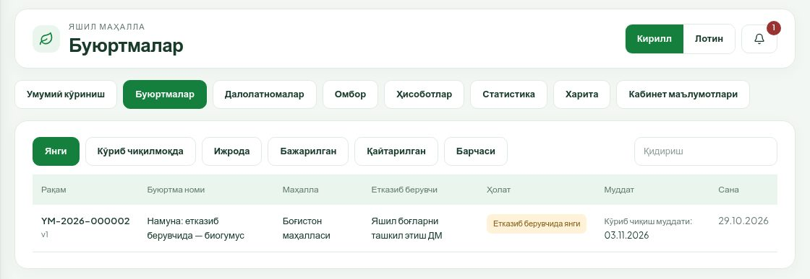

3. Қаторни босинг — буюртма карточкаси очилади. Юқорида босқич тасмаси (Буюртма → Уюшма → Етказиб берувчи → Ижро → Акт → Якун), остида маҳалла, уюшма бўлинмаси, манзил, жойлашув нуқтаси, майдон, маҳсулот ва хизматлар, ҳужжатлар ва жараён журнали.
4. Ҳолат ёнидаги ёзув кўриб чиқиш муддатини ва сарфланган иш кунини кўрсатади (масалан «1 / 3 сарфланди»). **3 иш куни** — уюшма ва етказиб берувчи учун **жами** муддат.
5. **Кўриб чиқишни бошлаш** тугмасини босинг. Буюртма «Етказиб берувчи кўриб чиқмоқда» ҳолатига ўтади ва иккита амал очилади: **Ижрога қабул қилиш** ва **Тузатиш учун қайтариш**.

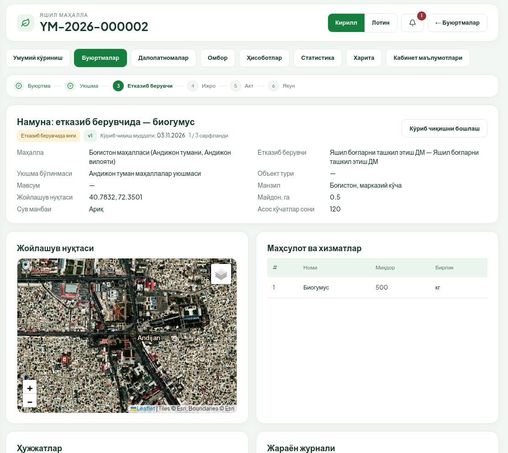

Текширинг: жой ва манзил, маҳсулотлар ва миқдор, иловалар, буюртманома (**Ҳужжатлар** блокида **Кўриш**, **Чоп этиш**, **PDF**).

### 2.1. Ижрога қабул қилиш

1. **Ижрога қабул қилиш** тугмасини босинг (тайёрловчи ҳуқуқи керак).
2. **Масъул ижрочи** майдонига ижрочи ходимни ёзинг (мажбурий).
3. **Буюртма, жой ва маҳсулотларни текширдим** белгисини қўйинг.
4. **Тасдиқлаш** тугмасини босинг.

Қабулдан кейин:

- буюртма **Ижрода** ҳолатига ўтади ва **10 иш кунилик етказиш муддати** бошланади (якшанба, шанба, байрамлар ҳисобга кирмайди). Муддат карточкада **Етказиш муддати** қаторида кўринади;
- ҳар бир товар сатри омбордан **ажратилади**, натижа карточкадаги **Ижрога қабулда омбор натижаси** жадвалида кўрсатилади (6-бўлимга қаранг).

**Ўрмон хўжалиги ва ДМ ўртасидаги фарқ:**

- **Ўрмон хўжалиги** буюртмани қолдиқ нол ёки етарли бўлмаса ҳам **тўлиқ қабул қилади**. Ҳисоб қолдиғи манфийга тушиши мумкин — бу хато эмас, «таъминлаш эҳтиёжи». Омборда қизил **Етишмовчилик** белгиси пайдо бўлади. (Бу сиёсат модул маъмурининг «Қоидалар» бўлимида белгиланади, стандарт қиймати — рухсат этилган.)
- **ДМ**да ҳар бир сатр учун етарли бўлиши шарт: товарда — омбор қолдиғи, хизматда — шу ойнинг **хизмат қуввати**. Биронта сатр етмаса, қабул рад этилади («Омборда ёки хизмат қувватида етарли ресурс йўқ — кирим киритиб қайта қабул қилинг») ва ҳеч нарса ёзилмайди. Аввал кирим ёки қувват киритинг, кейин қайта қабул қилинг.

Қабул бир марта бажарилади: такрор босилса ҳам буюртма иккинчи марта ажратилмайди.

### 2.2. Тузатиш учун қайтариш

Буюртмада хато бўлса (манзил, маҳсулот, меъёр ва ҳ.к.):

1. **Тузатиш учун қайтариш** тугмасини босинг.
2. **Сабаб тури**ни танланг: Манзил / жойлашув, Маҳсулот ёки миқдор, Етказиб берувчи, Ҳужжатлар / иловалар, Меъёрлар, Бошқа.
3. **Изоҳ (мажбурий)** майдонига нимани тузатиш кераклигини аниқ ёзинг.
4. Хоҳласангиз **Хато майдонлар** рўйхатидан хато жойларни белгиланг.
5. Пастдаги **Тузатиш учун қайтариш** тугмасини босинг.

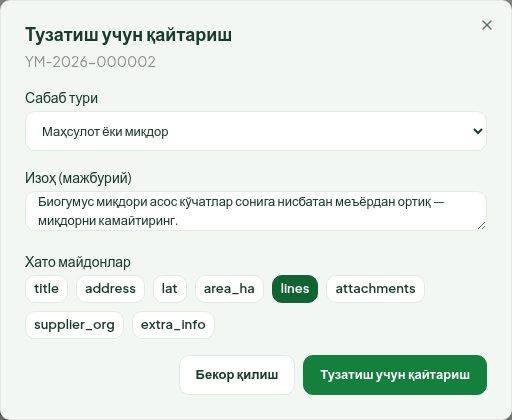

Буюртма тўғридан-тўғри маҳаллага қайтади («Маҳаллага қайтарилган»), уюшмага хабар боради. Маҳалла тузатиб, қайта имзолаб юборгач, буюртма уюшма орқали яна сизга келади; эски версия ва изоҳлар тарихда сақланади. Қайтарилган буюртма омборга таъсир қилмайди.

---

## 3. Ижродаги буюртма

**Ижрода** бўлимидан буюртмани очинг. Карточкада:

- **Масъул ижрочи**, **Ижрога қабул қилинган** вақт, **Етказиш муддати**;
- **Маҳсулот ва хизматлар** жадвалида **Қабул қилинган** (маҳалла тасдиқлаган) ва **Қолган** миқдор;
- **Ижрога қабулда омбор натижаси**: ҳар позиция бўйича қолдиқ «олдин → кейин» ва етишмовчилик;
- **Далолатномалар** блоки ва **Жараён журнали**.

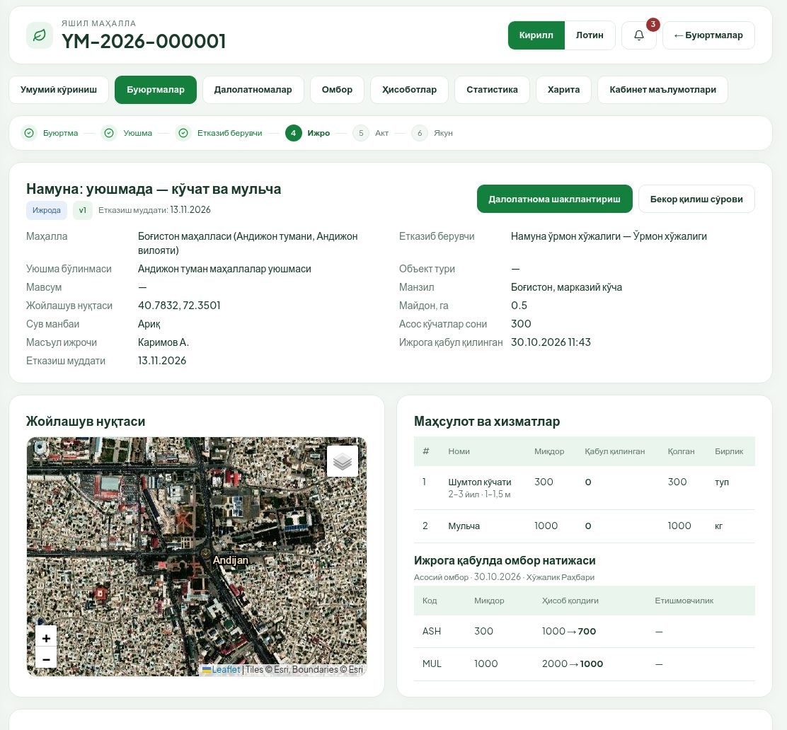

Етказиш муддатига 3 ва 1 иш куни қолганда эслатма келади; муддат ўтгач кечикиш иш кунлари билан қизил белги бўлиб чиқади ва ҳисоботларда кўринади.

---

## 4. Етказишни қайд этиш ва далолатнома

### 4.1. Далолатнома яратиш

1. Ижродаги буюртмада **Далолатнома шакллантириш** тугмасини босинг. (Тугма буюртмада очиқ акт ёки кўриб чиқилаётган бекор қилиш сўрови бўлмаса чиқади.)
2. **Ҳақиқий етказиш санаси** — келажак сана ва ижрога қабул санасидан олдинги сана қабул қилинмайди.
3. **Масъул шахс** (буюртмадаги ижрочи олдиндан ёзилган), **Етказиш манзили** (бўш қолса буюртма манзили), **Қўшимча маълумот ва қайдлар**.
4. **Маҳсулот ва хизматлар** жадвалида **Ушбу акт бўйича** устунига ҳақиқатда етказилган миқдорни ёзинг. Миқдор **Қолган** устунидан ошмайди. Етказилмаган сатрни **0** қолдиринг.
5. **Далолатнома яратиш** тугмасини босинг. Акт «Қоралама» ҳолатида очилади.

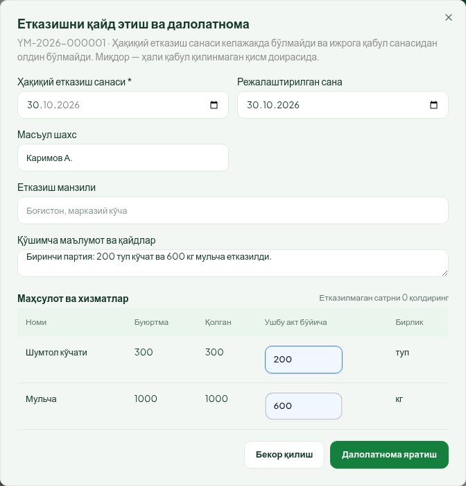

**Қисман етказиш.** Агар бирор сатр тўлиқ етказилмаса, акт **Қисман** белгиси билан яратилади. Қолган қисм учун кейин алоҳида акт тузилади. Бир буюртма бўйича бир вақтда фақат битта очиқ акт (қоралама, маҳалла тасдиғида ёки қайтарилган) бўлиши мумкин.

> **Режалаштирилган сана** (ихтиёрий) — етказиш олдиндан режалаштирилган бўлса шу ерда кўрсатилади (ТТ §10.1).

### 4.2. Далил файллари

1. Акт карточкасида **Етказишни тасдиқловчи ҳужжатлар** блокида **Файл қўшиш** тугмасини босинг (ёки юқоридаги **Файл қўшиш**).
2. Фото ёки PDF танланг: JPG, PNG, PDF; бир файл 10 МБгача.
3. **Имзолашдан олдин камида битта фото ёки PDF мажбурий** — акснинг ҳолда имзолаш рад этилади. Файл актнинг жорий версиясига боғланади.

Қоралама вақтида **Таҳрирлаш** (сана, миқдор ва б.) ва **Актни бекор қилиш** ҳам мумкин. Бекор қилинган акт қабул миқдорига таъсир қилмайди.

### 4.3. Имзолаш ва маҳаллага юбориш

Бу амални **имзоловчи** ҳуқуқи бор ходим бажаради.

1. Акт карточкасида **Имзолаш ва маҳаллага юбориш** тугмасини босинг.
2. **Далолатномани имзолаш** ойнасида ҳужжат олдиндан кўрсатилади — етказилган миқдорларни текширинг. Остида имзо режими ва ҳужжат хэши ёзилади.
3. Усулни танланг: **E-IMZO калит** (рўйхатдан сертификатни танланг) ёки **USB-токен** (токенни уланг).
4. Пастдаги **Имзолаш ва маҳаллага юбориш** тугмасини босинг ва E-IMZO сўраган паролни киритинг.

Имзо серверда текширилади: сертификатдаги ЖШШИР тизимга кирган ходимнинг ЖШШИРига, ташкилот СТИРи эса етказиб берувчи СТИРига мос бўлиши керак. Бошқа шахс сертификати билан имзолаб бўлмайди. Имзодан кейин акт **Маҳалла тасдиғида** ҳолатига ўтади ва маҳаллага хабар боради. Имзосиз акт маҳаллага юборилмайди.

### 4.4. Далолатнома карточкаси ва реестри

Акт карточкасида: ҳолат ва версия, **Буюртмага ўтиш** ҳаволаси, етказиш маълумотлари, сатрлар, далил файллари, **Ҳужжатлар** (имзолар, **Кўриш**, **Чоп этиш**, **PDF**), **Версиялар** ва жараён журнали.

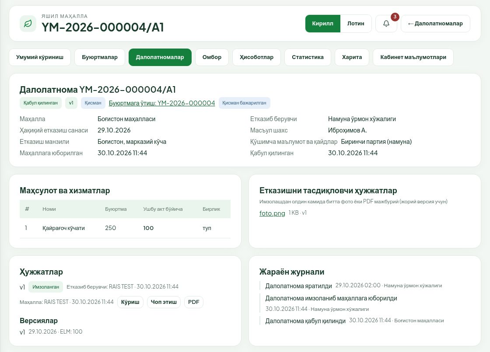

Маҳалла **Қабул қилиш ва имзолаш** қилгач, акт **Қабул қилинган** бўлади ва миқдор буюртманинг **Қабул қилинган** устунига қўшилади. Барча сатрлар тўлиқ қабул қилинса буюртма **Бажарилган**, акс ҳолда **Қисман бажарилган** ҳолатига ўтади. Икки томон имзолаган акт таҳрирланмайди.

**Далолатномалар** бўлимида бўлимлар: **Қоралама**, **Рад этилган** (маҳалла қайтарганлар), **Тасдиқ кутаётган**, **Қабул қилинган**, **Барчаси**.

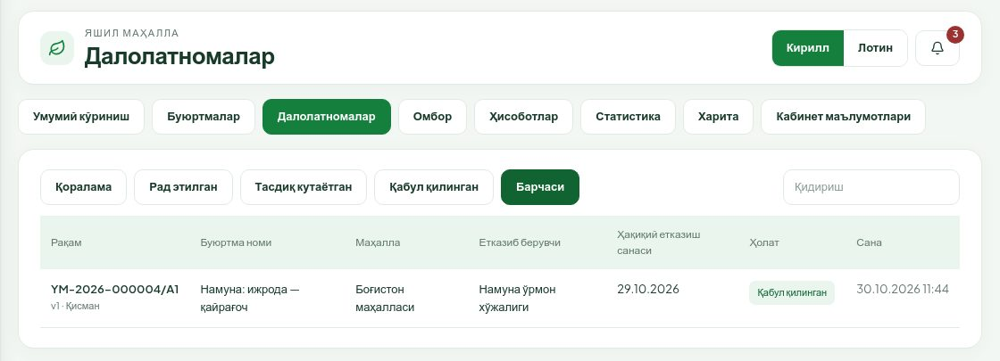

### 4.5. Маҳалла қайтарган акт

1. **Далолатномалар → Рад этилган** бўлимидан актни очинг. Юқорида **Маҳалла қайтарди** белгиси, сабаб тури (ҳужжат хатоси, миқдор фарқи, сифат, амалда етказилмаган, бошқа) ва изоҳ кўрсатилади.
2. **Таҳрирлаш** тугмасини босинг — **Далолатномани тузатиш (янги версия)** ойнаси очилади. Маълумотларни тузатиб **Сақлаш** ни босинг.
3. Акт янги версия рақами билан яна «Қоралама» бўлади; эски версия ва унинг имзоси «алмаштирилган» бўлиб сақланади.
4. Янги версия учун далил файлини қўшинг ва имзоловчи 4.3-бўлимдаги каби қайта имзолаб юборади.

Акт қайтарилгани буюртмани маҳаллага қайтармайди — тузатиш етказиб берувчининг вазифаси. Қайтарилган акт омбор қолдиғини оширмайди.

---

## 5. Ижродаги буюртмани бекор қилиш сўрови

Ижрога қабул қилингандан кейин буюртмани бир томонлама бекор қилиб бўлмайди. Маҳалла ёки етказиб берувчи **сўров** юборади, иккинчи тараф рози бўлади, уюшма тасдиқлайди.

**Маҳалладан сўров келса** (тайёрловчи ҳуқуқи керак):

1. Буюртмани очинг. Юқорида **Бекор қилиш сўрови** блоки: ҳолат («Сўралган»), сўровчи, сабаб ва бекор қилинадиган сатрлар (бутун қолдиқ ёки айрим сатрлар).
2. Рози бўлсангиз — **Бекор қилишга розилик** → **Тасдиқлаш**. Сўров «Иккинчи тараф келишган» ҳолатига ўтади ва уюшма тасдиғига боради.
3. Рози бўлмасангиз — **Бекор қилишни рад этиш**, **Рад этиш сабаби** ни ёзиб **Рад этиш** ни босинг.

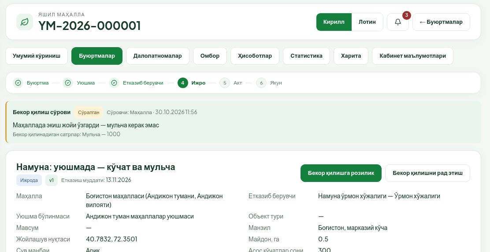

**Ўзингиз сўров юборсангиз:** ижродаги буюртмада **Бекор қилиш сўрови** → **Бутун қолдиқни бекор қилиш** ёки **Қисман (сатрлар бўйича)** (ҳар сатр учун миқдор) → **Сабаб (мажбурий)** → **Сўров юбориш**. Кейин маҳалла рози бўлади ва уюшма тасдиқлайди.

Шартлар: буюртмада очиқ акт бўлмаслиги керак; сўров кўриб чиқилаётганда янги акт тузилмайди. Уюшма тасдиқлагач фақат **етказилмаган ва қабул қилинмаган** қисм бекор бўлади, шу қисмга ажратилган омбор миқдори тикланади (ҳаракатлар тарихида «Тиклаш (бекор)»). Имзоланган ҳужжатлар ўзгармайди.

---

## 6. Омбор

**Омбор** бўлимида ташкилотнинг асосий омбори очилади.

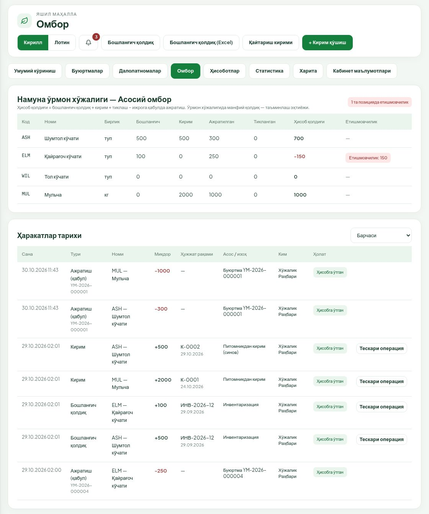

### 6.1. Қолдиқлар жадвали

Ҳар бир товар позицияси бўйича: **Бошланғич**, **Кирим**, **Ажратилган** (ижрога қабулда), **Тикланган** (бекор қилишда; қавс ичида қайтариш кирими), **Ҳисоб қолдиғи** ва **Етишмовчилик**.

- Ҳисоб қолдиғи = бошланғич қолдиқ + кирим + тиклаш − ижрога қабулда ажратиш.
- Манфий қолдиқ қизил рангда, ёнида **Етишмовчилик: N** белгиси; юқорида «N та позицияда етишмовчилик». Ўрмон хўжалигида бу таъминланмаган эҳтиёж, жисмоний манфий захира эмас. Кузатувчи ҳам бу белгини кўради.
- Қолдиқни тўғридан-тўғри таҳрирлаб бўлмайди — ҳар ўзгариш ҳужжатли ҳаракат орқали.
- Хизмат позициялари (масалан, ҳимоя хизмати) омборда юритилмайди — улар хизмат қуввати орқали (7-бўлим).

Позиция қаторини босинг — **Ҳаракатлар тарихи** шу позиция бўйича сузгичланади (яна босилса олиб ташланади). Ҳаракатлар тарихида ҳолат бўйича ҳам сузгич бор: **Ҳисобга ўтган**, **Тасдиқ кутилмоқда**, **Рад этилган**.

Юқоридаги тугмалар (фақат тайёрловчига): **Бошланғич қолдиқ**, **Бошланғич қолдиқ (Excel)**, **Қайтариш кирими**, **+ Кирим қўшиш**.

### 6.2. Кирим қўшиш

1. **+ Кирим қўшиш** тугмасини босинг.
2. **Номи** — позицияни танланг; **Миқдор** (бирлиги ёнида кўрсатилади); **Ҳужжат санаси** (келажак сана бўлмайди); **Ҳужжат рақами**; асос ҳужжат файли (**Файл қўшиш**: JPG, PNG, PDF); **Асос / изоҳ**.
3. **Сақлаш** ни босинг. Хабарда янги қолдиқ кўрсатилади.

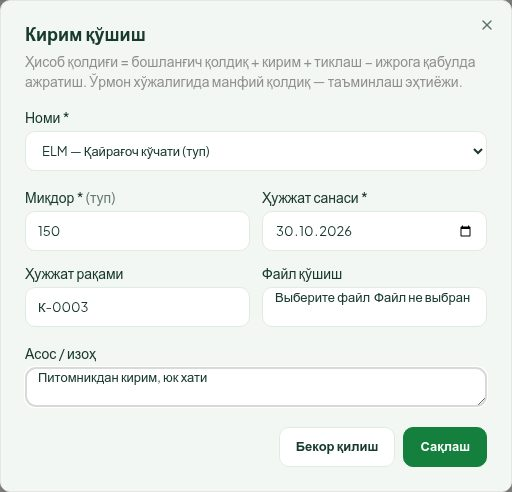

Шу рақамли кирим аввал киритилган бўлса, «Бу рақамли кирим аввал киритилган» огоҳлантириши чиқади — текширинг, такрор кирим бўлмасин.

### 6.3. Бошланғич қолдиқ

Бошланғич қолдиқ ҳар позиция учун **бир марта**, инвентаризация ҳужжати билан киритилади. Кейинги ўзгаришлар — кирим ёки тескари операция.

- **Қўлда:** **Бошланғич қолдиқ** тугмаси → позиция, миқдор, ҳужжат рақами ва санаси → **Сақлаш**.
- **Excel'дан:** **Бошланғич қолдиқ (Excel)** тугмаси.
  1. Устунлар: `каталог коди | миқдор | ҳужжат рақами | ҳужжат санаси | изоҳ` (сана `кк.оо.йййй` ёки `йййй-оо-кк`).
  2. .xlsx файлни танланг (10 МБгача) ва **Текшириш** ни босинг — ҳеч нарса ёзилмайди, натижа чиқади: «янги», «янгиланади», «ўзгаришсиз», «хато» ва хато қаторлар рўйхати.
  3. Хато бўлмаса **Тасдиқлаш ва ёзиш** очилади. Ёзиш «ҳаммаси ёки ҳеч нарса» тамойилида: битта хато қатор бўлса ҳам ҳеч нарса ёзилмайди.

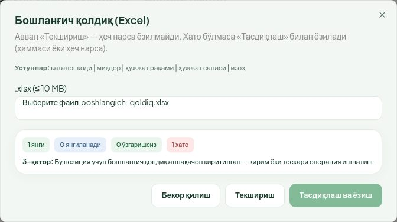

Расмдаги мисолда бир позиция учун бошланғич қолдиқ аввал киритилган, шунинг учун «хато» чиқди ва **Тасдиқлаш ва ёзиш** ёпиқ.

### 6.4. Қайтариш кирими

Аллақачон етказилган товар ҳақиқатда қайтиб келса, у **Қайтариш кирими** орқали киритилади (**Ҳужжат рақами** мажбурий). Маҳалла актни қайтаргани ўз-ўзидан омборни оширмайди.

### 6.5. Тескари операция

Ҳисобга ўтган ҳаракат ўчирилмайди — хато тескари ёзув билан тузатилади.

1. Тайёрловчи **Ҳаракатлар тарихи**да кирим, бошланғич қолдиқ ёки қайтариш кирими қаторидаги **Тескари операция** тугмасини босади.
2. **Асос (мажбурий)** ни ёзиб **Сўров юбориш** ни босади. Ҳаракат «Тасдиқ кутилмоқда» бўлиб туради, юқорида «Тасдиқ кутаётган тескари операциялар: N» белгиси чиқади.
3. **Имзоловчи** шу қаторда **Тасдиқлаш** ёки **Рад этиш** ни босади (рад этишда сабаб мажбурий). Тасдиқлангач тескари ёзув ҳисобга ўтади ва қолдиқ ўзгаради.

Ижрога қабулдаги ажратишни тескари операция билан ўзгартириб бўлмайди — бунинг учун бекор қилиш сўрови (5-бўлим) ишлатилади. Бир ҳаракат учун фақат битта тескари операция бўлади.

---

## 7. ДМ хусусиятлари

### 7.1. Каталог

ДМ буюртмаларида тўрт гуруҳ бор: **Органик ўғит** (масалан, биогумус), **Асбоб-ускуна** (челак, лейка, белкурак ва ҳ.к.), **Суғориш** (сув идиши, мотопомпа, шланг ва ҳ.к.) — бу товарлар омборда юритилади; **Ҳимоя хизмати** (касаллик ва зараркунандаларга қарши кураш) — хизмат, омборда эмас, ойлик қувват орқали ҳисобланади. Каталогни модул маъмури юритади.

### 7.2. Хизмат қуввати (ой бўйича)

ДМ омбори саҳифасининг пастида **Хизмат қуввати (ой бўйича)** блоки бор: **Давр** (ой) танланади, ҳар хизмат бўйича **Қувват**, **Сарфланган** (шу ойда ижрога қабул қилинган ҳажм) ва **Бўш**.

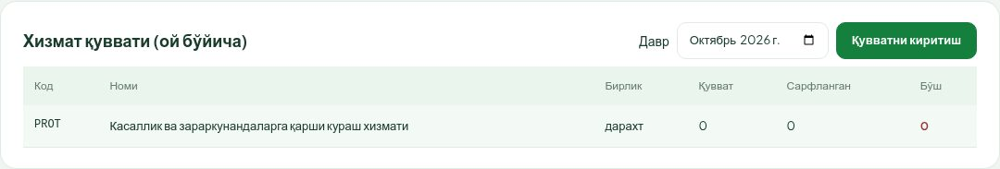

Қувватни ДМнинг **имзоловчи** ходими киритади:

1. **Давр** да ойни танланг.
2. **Қувватни киритиш** тугмасини босинг.
3. Ҳар хизмат учун **Қувват** ни ёзинг ва **Сақлаш** ни босинг.

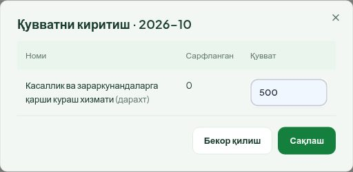

Қувват сарфланган ҳажмдан кам қилиб ўрнатилмайди. Ижрога қабулда хизмат сатри қабул қилинган ойнинг бўш қувватидан олинади; етмаса қабул рад этилади (2.1-бўлим). Модул маъмури ҳам исталган ДМ учун қувватни «Маъмурият» бўлимида киритиши мумкин.

### 7.3. ДМда ижрога қабулдан олдин

Ижрога қабулдан олдин ҳар бир товар сатри учун омборда етарли қолдиқ, хизмат сатри учун шу ойга етарли қувват борлигини текширинг. Етмаса — аввал **+ Кирим қўшиш** (ёки бошланғич қолдиқ) ва **Қувватни киритиш**, кейин **Ижрога қабул қилиш**.

---

## 8. Тез-тез учрайдиган хабарлар

| Хабар | Нима қилиш керак |
|---|---|
| «Омборда ёки хизмат қувватида етарли ресурс йўқ…» (ДМ, қабулда) | Кирим ёки қувват киритинг, кейин қайта қабул қилинг |
| «Бу буюртма бўйича очиқ далолатнома бор…» | Аввалги актни якунланг (имзолаб юборинг) ёки бекор қилинг |
| «Етказишни тасдиқловчи камида битта фото ёки PDF илова мажбурий» | Акт карточкасида далил файлини қўшинг |
| «Ҳақиқий етказиш санаси келажакда ва ижрога қабул санасидан олдин бўлмайди» | Санани тузатинг |
| «…қабул миқдори буюртмадан ошади» / миқдор қолгандан кўп | **Ушбу акт бўйича** миқдорни **Қолган** доирасида ёзинг |
| «Бу позиция учун бошланғич қолдиқ аллақачон киритилган…» | Кирим ёки тескари операциядан фойдаланинг |
| «Бу кабинетда … ҳуқуқи йўқ» | Ҳуқуқ бор ҳамкасбга мурожаат қилинг ёки маъмурдан ҳуқуқ сўранг |
